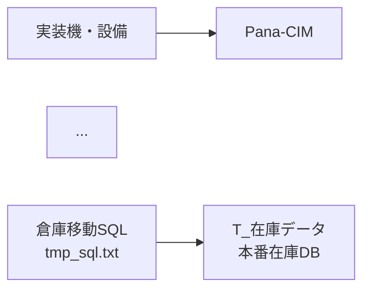
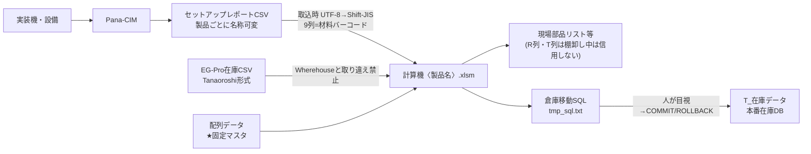

# 図解(drawio) 改善差分手順

対象: `00_inbox/篠原/固定テーブル棚卸作業/固定テーブル棚卸方法図解.drawio`
注意: 実体の drawio は drawio アプリ上で開いて適用する。XML 直接編集は座標破損リスクがあるため、以下は人手適用向けの手順。

## 適用手順(所要 約15分)

### ページ「1. 全体フロー」

| # | 対象要素 | 修正 |
|---|---|---|
| 1 | 凡例ノート(深灰背景、白字28px) | 背景を白、字を黒へ。スタイル変更例: `fillColor=#FFFFFF;strokeColor=#333333;fontColor=#000000;` |
| 2 | エッジ「無い」(id 17) / 「ある」(id 43) | ラベルを「なし」/「あり」へ統一 |
| 3 | 赤破線エッジ 3本(レポート再出力・設備操作やり直し・要確認BOX行き) | strokeColor を `#B85450` → `#E64A19` へ。「赤=実データ更新」と区別するため |
| 4 | 「セットアップレポート計算機TEC56.xlsm」等の製品名直書き | 「セットアップレポート計算機〈製品名〉.xlsm」へ(図中に例として TEC5600 を併記) |
| 5 | fontSize=13 以下のノート(方法2のSSMS手順ノート等) | 最低 13px を確保。印刷縮小を考慮し 14px 推奨 |

### ページ「サマリ」

| # | 対象要素 | 修正 |
|---|---|---|
| 6 | 人名(竹淵さん/生産一課)のラベル | 第三者向け資料では「作成者: 生産一課」程度へ一般化。または削除 |
| 7 | 「EG-Pro在庫更新の流れ(仮説)」ノート | 見出しから「仮説」を外せない場合は、色を黄色(未確定扱い)へ。正式フローと区別する |

### mermaid(詳細設計・仕様書 §2)

既存:

改善後(注意ラベルを追加):

### 適用後の確認

- [ ] 凡例が印刷(白黒)でも判読できる
- [ ] 分岐ラベルの表記が全ページで統一されている(なし/あり)
- [ ] 赤実線(要注意)と赤破線(やり直し)が色と線種の両方で区別されている
- [ ] 製品名直書きが無い(〈製品名〉+例)
