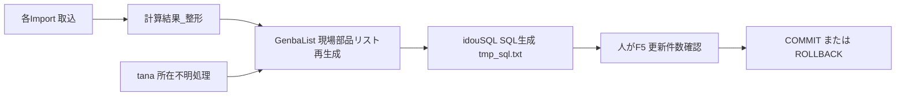

> 前提について: 本書は「改修部分を除き、これまで問題なく運用できていた」という実運用実績を前提とする。
> idouSQLの生成ロジックはv1.0から無改修で稼働しており(セットアップレポート計算機_仕様書v1.0)、
> v2.0の差異はidouSQL/AppendLineのコメント整形のみで、生成される実SQL本体は完全に一致する。
> したがって本書は「危険の列挙」ではなく「確立された仕様の記録」として記述する。
> 根拠はidouSQLのVBAソース本体(Module1.bas: GenbaList/idouSQL/AppendLine)と、
> セットアップレポート計算機_仕様書v1.0。

---
title: 倉庫移動SQL(idouSQL)仕様書
status: 初版（要レビュー）
updated: 2026-09-28
tags: [棚卸, 固定テーブル, idouSQL, 仕様書]
related: [[固定テーブル棚卸し_ドキュメント運用ルール（MOC）]]
対応製品: [AED, TEC1000, TEC5600, NKV, 送信機]
---

# 倉庫移動SQL(idouSQL)仕様書

## 1. この処理が何をするものか

idouSQLは、棚卸しで数え終えたリールのシリアル番号を対象に、EG-Proの本番在庫テーブル `T_在庫データ` のロケーションコード(と付随するステータスコード・ラインNo・設備No・Z軸No・更新日時)を、指定した棚卸し用倉庫コードへ一括で書き換えるSQLを生成する処理である(在庫数そのものは変えない)。

重要な性質として、idouSQLはDBを直接更新しない。組み立てたSQLをテンポラリの `tmp_sql.txt` に書き出して既定エディタで開くだけで、実際の実行(F5)とCOMMIT/ROLLBACKは人が手動で行う。本番在庫DBの誤更新を、人の目視確認を必ず挟むことで防ぐ設計である。この設計はv1.0から変わっておらず、実績のある運用形態である。

## 2. 実行前に何が揃っている必要があるか

- 直前に作り直した「現場部品リスト」(GenbaListの出力)。idouSQLはこのシートのD列(シリアル)だけを対象にSQLを組む(出典: idouSQL, GenbaList)。
- 「マクロ実行」シートA55に移動先ロケーションコードが入っていること。空なら「A55を確認してください」、非数値なら「数字になっていません」で中止する(出典: idouSQL 冒頭ガード)。A55初期値は201(出典: v1.0仕様書)。
- 「現場部品リスト」D2以降に実シリアルが1件以上あること。0件なら「移動対象のシリアル番号が見つかりませんでした」で中止する(出典: idouSQL targetCount判定)。
- 管理者権限のあるPCとSSMS環境。バックアップの SELECT INTO が権限を要する。

## 3. どの列が更新され、どの列が残るか

在庫数を変えないことがこの処理の要点である。棚卸しは現物の置き場所(ロケーション)を棚卸し用倉庫へ移すのが目的であり、数量そのものを増減させる操作ではない。

| 列 | 更新されるか | 更新後の値 |
|---|---|---|
| 在庫数 | 更新しない | 変更なし(SET句に存在しない) |
| ロケーションコード | 更新する | A55で指定した移動先コード |
| ステータスコード | 更新する | M_ロケーションから、移動先ロケーションコードに対応する値をサブクエリで取得 |
| ラインNo | 更新する | NULL |
| 設備No | 更新する | NULL |
| Z軸No | 更新する | NULL |
| 更新日時 | 更新する | GETDATE()(SQL実行時刻) |

(出典: idouSQL UPDATE SET句)

- 更新対象テーブル(確定): `[EGProKOHDEN-Warehouse].[dbo].T_在庫データ`
- ステータス参照元(確定): `[EGProKOHDEN-MST].[dbo].M_ロケーション` を `ロケーションコード = 移動先コード` で引く相関サブクエリ

## 4. 対象がどう決まるか

対象は「現場部品リスト」D列(シリアル)の空でないセルの列挙だけで決まる。

- IN句の組み立て(確定): D列の各シリアルを `'値'` で囲み `,` 連結して `IN('a','b',...)` を作る。値中の `'` は `''` にエスケープする(出典: idouSQL serialList生成ループ `Replace(..., "'", "''")`)。
- 件数計算(確定): 連結件数を `targetCount` として数え、ダイアログ・バックアップWHERE・UPDATE WHERE・想定件数コメントに共通で使う。
- WHERE句はシリアル番号の列挙だけで構成され、現在ロケーションを条件にしない(出典: idouSQL UPDATE ... WHERE シリアル番号 IN(...))。

この「WHEREがシリアル列挙のみ」という仕様は、GenbaListの直前再実行と対象リストの目視確認によって長年担保されてきた確立仕様である。運用手順を守る限り問題は生じていない。

## 5. 取り消せるのか、取り消せないのか

**バックアップの取得(確定)**
UPDATEの前に、対象シリアルの更新前レコードを日時付きバックアップテーブルへ退避する。
- テーブル名: `T_在庫データ_移動前BK_yyyymmdd_hhnnss`(実行日時付き。複数回実行しても上書きしない)
- 実装: `SELECT * INTO [EGProKOHDEN-Warehouse].[dbo].[BKテーブル] FROM ... T_在庫データ WHERE シリアル番号 IN(...)`

**トランザクション制御(確定)**
- `SET XACT_ABORT ON;` -> `BEGIN TRAN;` でUPDATEを囲む(エラー時は自動ロールバック)。
- UPDATE後に `SELECT @@ROWCOUNT AS 更新件数;`(想定 targetCount 件)と `SELECT @@TRANCOUNT AS 未確定トランザクション数;` を表示。

**COMMIT/ROLLBACKの判断基準(SQLコメントに明記)**
1. バッチをF5で一度実行し、表示された『更新件数』を想定件数と見比べる。
2. 一致 -> `COMMIT TRAN;` の行だけを選択してF5。
3. 不一致 -> `ROLLBACK TRAN;` の行だけを選択してF5。
4. 全文を再F5しない(UPDATE二重実行防止)。クエリウィンドウを閉じない(未確定のまま巻き戻る)。
5. 確定後、`SELECT @@TRANCOUNT;` が0であることを確認してから閉じる。

**切り戻し(復元)SQL(確定)**
生成SQL末尾に、コメントアウト済みの復元SQLが同梱される。バックアップテーブルと `T_在庫データ` をシリアル番号でJOINし、ロケーション/ステータス/ラインNo/設備No/Z軸Noを元値へ戻す(更新日時はGETDATE)。確定後に戻す場合だけコメントを外して実行する(出典: idouSQL 末尾の復元SQLブロック)。

これらトランザクション運用・バックアップ・切り戻しは、v1.0から無改修で運用されてきた既存の定着手順である。

## 6. 運用上の注意点(実績運用の前提となる手順)

以下は「危険」ではなく、これまで問題なく運用できてきたことを支える前提手順である。手順を外れると実績の範囲を出る。

| 注意点 | 手順を外れた場合に起こりうること |
|---|---|
| GenbaListを実行してからidouSQLを実行する | 古い対象リストで流れる |
| A55に当該ラインの正しいコードを入れる(初期値201のまま流さない) | 別ラインの棚卸し倉庫へ移す |
| 対象シリアルを実行前に確認する | 移動済み・対象外が混じっても止まらない(WHEREは現在ロケーションを見ないため) |
| 更新件数を想定件数と照合してからCOMMITする | 件数不一致の誤書き換えを確定 |
| SQL全文を再F5しない | UPDATE二重実行 |
| クエリウィンドウを閉じない | 未確定トランザクションが巻き戻る |
| 管理者権限PCで実行する | SELECT INTOが失敗する |

(出典: idouSQL ガード・出力コメント、v1.0仕様書 業務手順12)

## 7. 実行の記録として何を残すか

DB側にSQL実行者の記録は残らない。以下を手作業で控える。
- 実行者 / 実行日時
- 対象件数(targetCount) / 移動先ロケーションコード(A55値)
- バックアップテーブル名(`T_在庫データ_移動前BK_...`。完了ダイアログに表示される)
- COMMIT/ROLLBACKのどちらを選んだか

(出典: idouSQL 完了ダイアログ、v1.0仕様書 第6章相当)

## 8. 関連する処理とのつながり

- tana(所在不明リール抽出): EGProのステータス(E列)が「貯蔵」でない行を「所在不明リール」へ抽出(出典: Module1.bas tana)。
- GenbaList: 「計算結果_整形」をオートフィルタ(部品番号あり/シリアルあり/テーブル番号!=14)し「現場部品リスト」を生成。idouSQLの直前入力元。スプライシング品はメイン+後側の2行に分かれる(出典: Module1.bas GenbaList)。
- idouSQL: 現場部品リストD列から移動SQLを生成し `tmp_sql.txt` を開く(出典: Module1.bas idouSQL)。
- 各Import(EG_Import/HAIRETSU_Import/SETUPREPORT_Import): idouSQLの前段データ取込。

## 9. 既知の注意事項(実績運用と両立するもの)

これらは新規リスクではなく、v1.0仕様書が明記済みの既知事項である。

| # | 事項 | 位置づけ |
|---|---|---|
| 1 | Tanaoroshi形式では在庫数量が全件0で返るため、R列(新品判定)は常に丸、T列(使いかけ判定)は常に空になる | 目視判断は信用しない。ただしGenbaList/idouSQLの対象特定は数量列を参照しないため無影響(出典: v1.0仕様書 2026-09-14追記) |
| 2 | ステータスコードはM_ロケーションのサブクエリで取得する | v1.0から無改修の確立仕様。運用ルールとして「A55にはM_ロケーション登録済みコードのみ入力」を推奨(未登録だとステータスがNULLになりうるため) |

## 9-2. 見出し1件問題（実際に発生した）

0件判定は**空欄だけ**を対象外にする。そのため、現場部品リストの `D2` に
「シリアル」という**見出し文字が残っていると有効値とみなして通る。**
実際に、対象が見出し1件だけで実データが一件も入らない出力が出たことがある。

**必ず `GenbaList`（現場部品リスト作成）を先に実行し、D列に実データが
並んでいることを目で見てから流す。** 0件停止は、この事故を防げない。

出典: 解決課題\[WIP]固定テーブル棚卸し 詳細設計・仕様書.html（2026-09-04）

## 10. 要確認事項(運用者にしか答えられないもの)

| # | 要確認事項 | 理由 |
|---|---|---|
| 1 | LINE2の3製品(TEC5600・TEC1000・送信機)で202以外を使う条件 | A55へ入れるコードの境目が資料上未確定 |
| 2 | 213(トレイ倉庫)とテーブル14の関係。A55に213を使ってよいか | トレイ部品の移動先が未確定 |
| ~~3~~ | ~~バックアップテーブルの保管期間・削除ルール~~ | **2026-09-04 に決着済み。** 一時退避の位置づけで保管期間は定めない |
| ~~4~~ | ~~実行者記録の正式な残し方~~ | **2026-09-04 に決着済み。** 実行者の追跡は本件の要件としない。DBに残るのは更新日時のみで、優先するのは確実に実行できること |
| 3 | idouSQL実行の**承認者** | 実行者記録とは別。誰がGOを出すかは未確定のまま |
| 4 | SELECT INTO の権限 | **本件では決着済み**（管理者権限前提でそのまま実行可）。固定テーブルへの差し替えが要るのは、権限のない別環境へ横展開する場合だけ |
