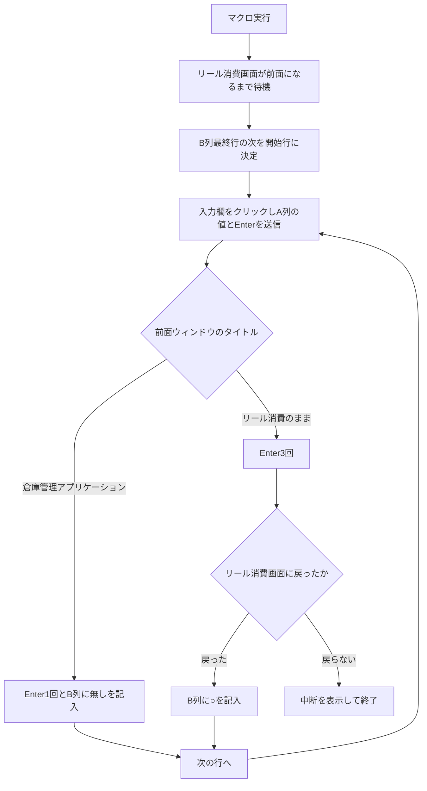

![[スクリーンショット 2026-09-16 164757.png]]

![[スクリーンショット 2026-09-16 164733.png]]---
title: ゼロ確認マクロ 仕様書兼実行手順書
created: 2026-09-16
tags: [棚卸, VBA, 倉庫管理アプリケーション, 0確認,マクロ]
status: 未検証
---

# ゼロ確認マクロ_仕様書兼実行手順書

> **2026-10-22 注記。** 本書は 2026-09-16 時点の仕様記録で、要確認を多数残したままだった。運用確定質問票（Q1〜Q35）の回答で埋まった項目の確定値は [[0確認マクロver2_運用手順]] にある。承認は不要（Q6-D）、実行時間帯は棚卸作業時間中（Q9-C）、クリック座標と VBA の変更は現場責任者の判断で可能（Q24-G・Q4-C）、A 列の対象一覧は Input0 ボタンの CSV 取込で作る（Q35-C・2026-10-22 実装、操作は [[0確認マクロver2_変更記録_2026-10-22]]）。「○」の意味は消し込み可能＝在庫ゼロ（Q18-E）、「無し」の意味は未決（Q19）。本書の本文は当時の記録として保持する。

## 1. 目的

棚卸を始める前に、A列の番号を倉庫管理アプリケーションへ順に照会し、結果をB列に記録する。この処理が終わっていないと棚卸には入れない。

## 2. 仕様

### 2.1 対象と構成

| 項目         | 内容                                                              |
| ---------- | --------------------------------------------------------------- |
| ブック        | 0確認マクロ.xlsm（マクロ有効ブック）                                           |
| 保存場所       | 要確認                                                             |
| 標準モジュール    | Module1、Module2の2つ。Module1にゼロ確認、Module2にgetMouseCoordinateが入る。  |
| 実行するプロシージャ | `ゼロ確認`                                                          |
| 補助プロシージャ   | `テスト用`（座標とウィンドウタイトルの確認用）、`getWindowTitle`（前面ウィンドウのタイトルと左上座標を返す） |
| 連携先        | 倉庫管理アプリケーションのリール消費画面                                            |
| Excelバージョン | 未指定。コードは`#If Win64`で32ビット版と64ビット版に分岐する                          |

### 2.2 入力

- マクロ実行時にアクティブなシートのA列。1行目からA列の最終行までが処理対象になる。
- リール消費画面の入力欄。マクロはここへキー入力を送る。

### 2.3 出力

- 同じシートのB列。該当ありなら「○」、該当なしなら「無し」を1行ずつ書き込む。
- 処理が続行できない場合は「中断」というメッセージボックスを出して終了する。

### 2.4 処理の流れ

1. 前面ウィンドウのタイトルが「リール消費【倉庫管理アプリケーション】」になるまで待ち続ける。一致したら500ミリ秒待つ。
2. B列の最終行を調べる。1行目なら開始行を1、そうでなければ最終行の次を開始行にする。
3. 開始行からA列の最終行まで、次を繰り返す。
   - ウィンドウ左上の座標に横180、縦69を足した位置へカーソルを移動し、左クリックする。
   - A列の値を送信し、500ミリ秒後にEnterを送る。
   - 500ミリ秒後に前面ウィンドウのタイトルを読む。
   - タイトルが「倉庫管理アプリケーション」なら、Enterを1回送ってB列に「無し」を書く。
   - それ以外なら、Enterを3回送る。その時点でタイトルが「リール消費【倉庫管理アプリケーション】」でなければ「中断」を出して終了する。戻っていればB列に「○」を書き、3行先のセルへ表示を移す。
   - 行の最後にもう一度タイトルを確認し、リール消費画面でなければ「中断」を出して終了する。



### 2.5 座標の考え方

マクロはウィンドウの左上座標を基準にクリック位置を決める。ブックに残っている実測値は、ウィンドウ左上が横99と縦248、入力欄上のカーソルが横279と縦317で、差は横180と縦69。コード中の`WindowX + 180, WindowY + 69`はこの実測に対応する。画面解像度や表示倍率、ウィンドウの最大化状態が変わるとこの差も変わる。

## 3. 影響範囲と取り消し可否

触る対象は、リール消費画面と、0確認マクロのブックのA列とB列。実行中はカーソル移動、左クリック、キー入力が人の操作と同じ経路でアプリへ届くため、他のウィンドウを前面に出すとそちらへ番号とEnterが入る。

B列への書き込みは、保存前ならブックを保存せずに閉じれば戻せる。アプリ側は事情が違う。Enterの送信が照会だけで終わるのか、消費や伝票の登録まで進むのかはコードから読み取れない。取り消し可否の判定もそこに依存する。**実行前に、Enter送信でアプリ側に何が確定するかを確認すること。要確認。**

対象の倉庫管理アプリケーションが本番かテストかも要確認。

## 4. 前提条件

- 実行端末はWindows。マクロ有効ブックを開ける環境で、倉庫管理アプリケーションとExcelを同じ端末で動かす。使用する端末の指定は要確認。
- 前回実行時と同じ画面解像度、同じ表示倍率で動かす。設定値は要確認。
- 倉庫管理アプリケーションへログインし、リール消費画面を開ける権限を持つアカウント。アカウントとパスワードはこの文書に書かない。保管先は要確認。
- アプリの起動方法。デスクトップアプリのためURLはコードから読み取れない。ショートカットの場所と、仕様書および手順書を置くObsidianの保管先は要確認。
- A列に入れる確認対象の一覧。作成者と受け渡し方法は要確認。
- 実行の承認者、実行可能な時間帯、目安所要時間は要確認。
- アプリが異常終了したときのリカバリ手順の参照先は要確認。
- 実行ログとスクリーンショットの保存先は要確認。

この手順はテスト環境での事前検証を行っていない。未検証のまま記載している。

## 5. 作業手順

### Step 1 作業フォルダを決めてバックアップを取る

ブックのある場所でPowerShellを開き、次を実行する。`<作業フォルダ>`は実際のパスに置き換える。パスは要確認。

```powershell
cd "<作業フォルダ>"
Copy-Item ".\0確認マクロ.xlsm" ".\backup\0確認マクロ_$(Get-Date -Format yyyyMMdd_HHmmss).xlsm"
Get-ChildItem ".\backup" | Sort-Object LastWriteTime -Descending | Select-Object -First 3 Name, Length, LastWriteTime
```

確認。最終行に今の日時を含むファイル名が並び、Lengthが0でないこと。backupフォルダが無い場合は`New-Item -ItemType Directory .\backup`で作ってから実行する。

### Step 2 ブックを開き、マクロを有効にする

0確認マクロ.xlsmを開く。上部に「セキュリティの警告」が出たら「コンテンツの有効化」を押す。

確認。警告バーが消えている。Alt+F11でVisual Basic Editor（VBA、Excelのマクロを書く画面。以下VBE）を開き、左のプロジェクトウィンドウにModule1とModule2が並ぶこと。

### Step 3 コンパイルを通す

VBEのメニューから「デバッグ」の「VBAProjectのコンパイル」を実行する。続けてCtrl+Gでイミディエイトウィンドウ（VBEでコードの実行結果を表示する入力欄。以下イミディエイト）を開き、次を貼り付けてEnterを押す。

```vba
?Application.VBE.ActiveVBProject.VBComponents.Count
```

確認。
- [ ]  エラーダイアログが出ないこと。
- [ ] 表示された数と、プロジェクトウィンドウのモジュール数が一致すること。`Sub ゼロ確認`がどちらのモジュールにあるかを開いて確かめ、この文書の2.1へ書き足す。
注意。`Type coordinate`と`Declare Function GetCursorPos`は2か所に書かれている。標準モジュールで両方とも公開宣言になっていると名前の重複でコンパイルが通らない。その場でコードを直さず、どちらを残すかを要確認とする。

### Step 4 対象シートの件数を数える

処理するシートを開き、空いているセル（例としてE1）に次を入れる。

```excel
=COUNTA(A:A)
```

E2に次を入れる。

```excel
=COUNTA(B:B)
```

E3に、A列に値があってB列が空の行数を出す。

```excel
=SUMPRODUCT((A1:A100000<>"")*(B1:B100000=""))
```

確認。E1が今回の対象件数、E2が記入済み件数、E3が残件数になる。E1からE2を引いた値とE3が一致すること。三つの値を作業記録に控えてから、E1からE3を削除する。

注意。マクロはB列の最終行の次から再開する。全件やり直したい場合はB列を消す必要があるが、消してよいかの判断基準は要確認。マクロはシートを指定せず`Cells`を使うため、実行時に前面のシートがそのまま対象になる。

### Step 5 リール消費画面を開く

倉庫管理アプリケーションにログインし、リール消費の画面を出す。画面までのメニュー操作は要確認。

確認。タイトルバーが「リール消費【倉庫管理アプリケーション】」と一字一句一致していること。マクロはこの文字列の完全一致だけで画面を判定するので、違えば待機したまま先へ進まない。

### Step 6 クリック位置を実測する

リール消費画面を前面にし、マウスカーソルを入力欄の上に置く。VBEで`テスト用`を実行し、5秒以内にリール消費画面をクリックして前面へ戻す。イミディエイトに、ウィンドウタイトル、ウィンドウ左上の座標、カーソル座標が出力される。

確認。カーソル座標からウィンドウ左上座標を引いた差が、横180と縦69に一致すること。出力された3行をそのまま作業記録へ貼り付ける。

差が合わない場合、コードの`SetCursorPos WindowX + 180, WindowY + 69`を変える必要がある。変更の可否と承認者は要確認。自分の判断で数値を書き換えない。

### Step 7 ゼロ確認を実行する

対象シートを表示した状態でAlt+F8を押し、一覧から`ゼロ確認`を選んで「実行」を押す。実行したらすぐリール消費画面をクリックして前面に出す。

確認。カーソルが入力欄へ動き、番号が入力され、B列が上から順に埋まり始めること。

注意。Excelが前面のままだと、マクロは待機ループに入ったまま何も起こさない。止まって見えるのは待機中の状態で、この待機をEscで抜けられるかは要確認。

### Step 8 実行中は端末に触れない

処理が終わるまでマウスとキーボードを操作しない。画面ロックとスクリーンセーバーが入らないようにする。通知ウィンドウが前面に出ると入力がそちらへ飛ぶため、通知は事前に止める。止め方の指定がないため、設定変更の可否は要確認。

確認。A列の表示位置が3行ごとに動き、B列の記入が進んでいること。

### Step 9 結果を照合する

処理が最終行まで進んだら、VBEで新しい標準モジュールに次を貼り付けて実行する。件数がイミディエイトに出る。

```vba
Sub 結果照合()
    Dim lastA As Long, lastB As Long
    lastA = Cells(Rows.Count, 1).End(xlUp).Row
    lastB = Cells(Rows.Count, 2).End(xlUp).Row
    Debug.Print "実行日時: " & Now
    Debug.Print "シート名: " & ActiveSheet.Name
    Debug.Print "A列最終行: " & lastA & " / B列最終行: " & lastB
    Debug.Print "○の数: " & Application.CountIf(Columns(2), "○")
    Debug.Print "無しの数: " & Application.CountIf(Columns(2), "無し")
    Debug.Print "未処理行数: " & Application.SumProduct( _
        (Range("A1:A" & lastA) <> "") * (Range("B1:B" & lastA) = ""))
End Sub
```

確認。A列最終行とB列最終行が同じ数であること。「○」と「無し」の合計がB列最終行と同じであること。未処理行数が0であること。出力された6行をすべて作業記録へ貼り付ける。

「○」と「無し」が在庫の何を指すかはコードから読み取れない。結果の読み方は要確認。

### Step 10 中断が出た場合

メッセージボックスに「中断」が出たらマクロは止まっている。OKを押し、アプリの画面を撮って画像として保存する。保存先は要確認。Step 9の`結果照合`を実行し、止まった時点のB列最終行を記録する。アプリの画面をリール消費画面へ戻す。

原因を確かめずに再実行すると、同じ場所で再び止まるか、想定外の画面へ入力が飛ぶ。再実行の可否は要確認。

### Step 11 保存して終了する

Ctrl+Sでブックを保存する。イミディエイトの出力と撮った画像を作業記録にまとめ、指定の保存先へ置く。保存先は要確認。倉庫管理アプリケーションからログオフし、Excelを閉じ、端末からサインアウトする。

確認。保存後のファイルの更新日時が今の日時になっていること。

```powershell
Get-ChildItem "<作業フォルダ>\0確認マクロ.xlsm" | Select-Object Name, Length, LastWriteTime
```

## 6. 想定ケースと対処

| 想定ケース | 起きている状態 | 対処 | 対処後の確認 |
|---|---|---|---|
| 実行しても何も動かない | 前面ウィンドウのタイトルが一致せず待機している | リール消費画面をクリックして前面に出す | カーソルが動き、B列の記入が始まる |
| Excelや別アプリに番号が入る | 実行中に別ウィンドウが前面になった | 入力内容を取り消してマクロを止める。停止操作は要確認 | Step 9の`結果照合`で未処理行数と最終行を突き合わせる |
| 入力欄以外がクリックされる | 横180と縦69の差が今の画面と合っていない | Step 6で座標を測り直す。コード変更の可否は要確認 | 測った差が横180と縦69に一致する |
| 「中断」が出て止まる | Enter送信後にリール消費画面へ戻らなかった | Step 10に従い、画面と停止行を記録する | B列最終行が記録した行と一致する |
| コンパイルが通らない | Module1とModule2で同じ宣言が重複している | コードを書き換えず、残す宣言を要確認とする | 「VBAProjectのコンパイル」でエラーが出ない |
| B列が途中から埋まる | 前回の結果が残り、その次の行から再開した | 意図した再開かを確認する。全件やり直しの基準は要確認 | 開始行がB列最終行の次である |
| 番号が途中までしか入らない | 500ミリ秒の待機に対してアプリの応答が遅い | いったん止め、該当行のB列を消して再実行する。待機時間の変更可否は要確認 | 該当行にB列の値が入り、未処理行数が0になる |
| 実行中に画面がロックされる | 無操作のままロック設定の時間が経過した | ロックを解除し、Step 9で停止行を確かめてから再開する | 未処理行数と残件数が一致する |

## 7. 自己チェック

- [ ] 実行前にバックアップを取り、ファイル名と日時を控えた。
- [ ] A列の件数、B列の記入済み件数、残件数の3つを控えた。
- [ ] Step 6の実測値をイミディエイトの出力ごと記録に貼った。
- [ ] 実行中に端末へ触れなかった。 
- [ ] Step 9の出力6行をすべて記録に貼った。
- [ ] 未処理行数が0で、「○」と「無し」の合計がB列最終行と一致した。
- [ ] ブックを保存し、更新日時を確かめた。
- [ ] アプリからログオフし、端末からサインアウトした。

## 8. 未検証の箇所とレビュー観点

- Enterの送信がアプリ側で何を確定させるかを検証していない。照会だけで終わるのか、登録まで進むのかで取り消し可否が変わる。ここが埋まるまで本番での実行判断はできない。
- 「無し」が記録された行の挙動を実データで確認していない。手元のシートはB列がすべて「○」で、「無し」の経路は動作例が残っていない。
- 待機時間はどの分岐も一律500ミリ秒。アプリの応答が遅い場面で足りるかを測っていない。
- Step 6の座標実測とStep 9の件数照合は確認の目的が違う。前者は入力位置、後者は結果の網羅性を見る。重複ではない。
- 画面座標に依存する部分は、入力欄をコントロール名で特定できれば座標の実測ごと省ける。実装の可否は要確認。
- Step 9の照合はすでにマクロ化した。バックアップの取得とイミディエイト出力のファイル保存も同じ形でまとめられる。

## 9. 要確認の一覧

ブックの保存場所、Module1とModule2の役割、アプリの起動方法とログイン情報の保管先、リール消費画面までのメニュー操作、Enter送信でアプリ側に確定する内容、実行端末と画面設定、承認者、実行可能な時間帯と所要時間、A列データの作成者、記録の保存先、「○」と「無し」の意味、待機時間と座標を変更してよいかの判断。

この12点のうち、Enter送信の影響だけは実行前に埋める。残りは手順を進めながら埋めても作業は止まらない。

[[棚卸シミュレーション_現場確認事項]]

|                                            |     |
| ------------------------------------------ | --- |
| ![[スクリーンショット 2026-09-16 164757 1.png]]     |     |
| ![[スクリーンショット 2026-09-16 164733 1.png]]<br> |     |
