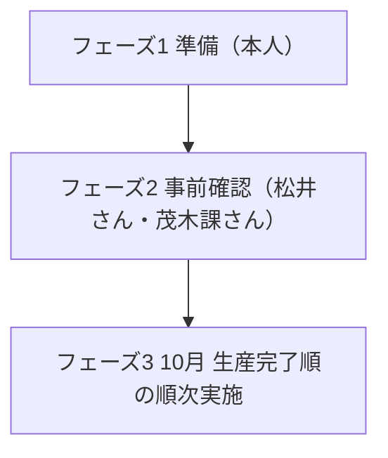

棚卸方法の具手隊的な手順については
# 棚卸シミュレーション実行計画

#WIP

> [!info] 起票の経緯
> 起票 2026-09-10。担当は本人主体。9/10予定だった現場確認は中止となり、まず本人が準備を固めてから松井さん・茂木さんを事前確認に招集する流れへ切り替えた。10月は生産が終わったラインから順に棚卸作業を進める。

> [!note] 2026-09-10 追記
> 現場確認事項8項目の聞き取り結果が出たため、確定と未確定を反映した。フェーズ3は全ライン一律ではなく生産完了順の運用へ書き換えた。

> [!note] 2026-09-14 追記
> 移動先コードがロケーションマスタで確定した。201が棚卸_1ライン倉庫、202が棚卸_2ライン倉庫、203が棚卸_3ライン倉庫、213が棚卸_3ライントレイ倉庫。208は現行マスタになく過去の一時利用と整理した。これに伴い、移動先コードを未確定として扱っていた各項を確定側へ移した。

---

## 🧭 全体像と依存関係

3フェーズを上から順に進める。前フェーズが固まらないと次へ進めない依存関係がある。

*   **フェーズ1が固まらない** → フェーズ2の招集で見せる手順書が用意できない
    
*   **フェーズ2で手順が確定しない** → フェーズ3の日程が動かせない
    

---

## ✅ 聞き取り・調査で確定したこと

**テーブル番号14** はトレイ部品のため除外。50円以上の部品で全数カウント対象、いったん全部倉庫に戻す運用。設備に部品が付いた状態では棚卸をしない

**所在不明リールの抽出基準** は「場所で判断する棚基準」→「モノの状態で判断する貯蔵以外基準」へ変更。二ライン倉庫・三ライン倉庫は貯蔵に含み、それ以外を探す。旧新でほぼ同じものを指し、監査時に部品の所在を説明できる状態を保つ仕組み

**idouSQLの実行環境** は管理権限のあるPCで実施。この前提は当面変わらない。今回の対象環境では「実行できそう」が最終結論

**移動先の倉庫コード** はロケーションマスタで確定。201が棚卸_1ライン倉庫、202が棚卸_2ライン倉庫、203が棚卸_3ライン倉庫、213が棚卸_3ライントレイ倉庫。いずれもステータスは貯蔵。208は現行マスタになく過去の一時利用。コードは棚卸し対象のラインごとに選び、A55へ入れる

## ⚠️ 聞き取りでも未定のまま残ったこと

> [!warning] 本番実行前に埋める必要がある未確定事項
> 
> *   **FaildSplice_OK**：「スプライシングができているかを確認するもの」という説明にとどまり、使用条件・実行者・承認者・事後確認者・記録方法・K26の入力形式はいずれも未回答
>     
> *   **所在不明リール抽出条件の変更理由・決定者**：特定できず。変更理由は不明のまま進める方針で合意。指摘時に理由を説明できないリスクは残す
>     
> *   **セットアップ情報が取れない部品の手動処理**：文書化されておらず、おそらく佐藤さんが一人で対応。属人化リスク
>     
> *   **倉庫コードの採番の正式ドキュメント**：確認できず。管理元はロケーションマスタだが、採番ルールの一次資料は未確認。関口さんか部品管理への確認が要る。採番は発注番号順ではなく、日本光電に入ってきた順（＝ラベルを貼った順）で決まる
>     

---

## 🔧 フェーズ1 準備（本人）

### ステップ1 流れの通し確認

- [ ] 詳細設計・仕様書v2の手順1〜10を頭からトレースし、各段の詰まりを洗い出す
    
    *   設備操作／セットアップレポート出力／EG-Pro在庫出力／マクロ実行／スプライシング切替失敗処理／カウント前準備／カウント実施／入庫処理／所在不明リール処理／部品取り付け
        

- [ ] 詰まった箇所はステップ3の確定項目へ送る
    
    *   基準ライン：**TEC5600のL2**
        

### ステップ2 使用ファイルとツールの不足チェック

- [ ] 下記一式がそろっているか確認する
    
    *   `セットアップレポート計算機TEC56.xlsm`
    *   `不足部品リスト作成ver7.xlsm`
    *   `EGProWhereHouse.csv`（EG-Pro在庫）
    *   Pana-CIM出力のセットアップレポートCSV
    *   固定テーブル配列データ
    *   `Get_EG_Tanaoroshi.cgi` / `Get_EG_Wherehouse.cgi`（EG-Pro出力用）
    *   SQLを流す実行環境
        

- [ ] **cgiの用途取り違え防止**：棚卸し＝Tanaoroshi、不足部品リストのB列更新＝Wherehouse、という使い分けをファイル準備時点で明示
    
    *   SQL実行は管理者権限のあるPCで行う前提が確定
        

### ステップ3 判断が不明な箇所の確定

> [!check] 机上調査から外す（確定済み）
> 
> *   テーブル番号14の除外理由 → 手順書へ反映
> *   所在不明リール抽出の基準変更 → 手順書へ反映。ただし**変更理由・決定者は不明のまま進める合意**であり、監査で問われた際に説明できないリスクを手順書に明記
> *   移動先の倉庫コード → ロケーションマスタで確定（201/202/203/213）。手順書へ反映。208は過去の一時利用として注記
>     

- [ ] **机上でなお詰める項目**

- [ ] EG-Pro在庫CSVの3列目・4列目・11列目の対応づけ

- [ ] TEC56の列参照仕様と、手順3でTanaoroshi形式を使って支障が出ないかの裏取り

- [ ] CSVを書き出している物理ジョブの特定

- [ ] 計算結果整形の20列目とA〜G列の定義

- [ ] 配列シートA〜E列の項目名

- [ ] 倉庫コードの採番ルールの一次資料は関口さんか部品管理へ確認する

### ステップ4 idouSQLの安全装置の再検証

> [!danger] データ破壊リスクの中核
> WHERE句はシリアルの列挙だけで現在ロケーションを条件にしないため、対象外シリアルが混じればそのまま書き換わる。

- [ ] 現場部品リスト作成を先に実行し、D列に実データが並ぶのを目視してから流す手順を机上でなぞる

- [ ] **不具合の再現条件を固める**：現場部品リストのD2に見出し「シリアル」が残ると0件判定を通過し、見出し1件だけで流れる不具合が実際に発生している

- [ ] 防御は「実行前のリスト目視」と手順書に明記

- [ ] COMMITとROLLBACKは更新件数を見てから選ぶ運用を守る

- [ ] A55へ入れる移動先コードは、処理するラインに対応する確定値（201/202/203/213）を対応表から選ぶ。トレイ部品は213を使う

### ステップ5 操作手順書の作成

- [ ] はじめて作業する人が単語ひとつで迷わず手を動かせる粒度で書く

- [ ] 詳細設計・仕様書v2を土台に、実際に進める手順版へ落とす

- [ ] 図解は `drawioの固定テーブル棚卸方法図解` を正とし、記述が食い違う場合は実機適用済みのdrawioとサマリv2を優先。ただしA55を202と直書きした箇所は古い記述として対応表の値を使う

- [ ] 確定したテーブル14の扱い、所在不明リールの貯蔵以外基準、移動先コードの確定値を反映

- [ ] FaildSplice_OKの運用・手動処理の担当は「未確認」として明示

- [ ] セットアップ情報が取れない部品の手動処理が佐藤さん一人に依存している点を属人化リスクとして注記

---

## 👥 フェーズ2 事前確認（松井さん・茂木さんを招集）

- [ ] 手順書が形になった段階で二人へ日程を打診する

- [ ] 実際に進める手順を頭から突き合わせる

- [ ] テーブル14・所在不明リール基準・移動先コードは確定済みのため記載確認にとどめる

- [ ] **異常系の取り決めをここで詰める**：FaildSplice_OKの使用条件・実行者・承認者・事後確認者・記録の残し方・K26の入力形式

- [ ] 倉庫コードの採番ルールの一次資料を、この場か関口さん・部品管理への確認で埋める

- [ ] 手動処理の担当分散も課題として上げる

---

## 📅 フェーズ3 10月の生産完了順の順次実施

- [ ] 対象ラインは固定ではなく、生産が終わった順に処理する運用と確定
    

- [ ] 清算が終わったラインからセットアップレポートを取り、順次進める

- [ ] L2のみかL1・L3も含むかは事前に固定しない（10月時点の生産完了状況に依存）
    
    *   基準は **TEC5600のL2起点**、完了したラインから着手
        

- [ ] ラインごとにセットアップレポートと配列の範囲が変わるため、着手のたびに対象ラインのテンプレを選び直す。あわせてA55へ入れる移動先コードもそのラインの値へ切り替える

- [ ] 実施日は生産完了の見込みに合わせて随時割り当てる

---

## 🔻 未確定として引き継ぐもの

- [ ] FaildSplice_OKの使用条件・承認フロー・記録方法・K26の入力形式 → 未定

- [ ] 所在不明リール抽出条件の変更理由・決定者 → 不明のまま進める

- [ ] セットアップ情報が取れない部品の手動処理 → 未文書化・佐藤さんに属人化

- [ ] 倉庫コードの採番ルールの正式ドキュメント → 未確認、関口さんか部品管理へ

- [ ] バックアップテーブルの保管期間・削除ルール → 未定

- [ ] FaildSplice_OKの実行ログ保存ルール → 未定

> [!quote] 中長期の背景（共有事項）
> 佐藤さん作成のシステムは補助的な位置づけで、本来は棚卸システムとして正式に整備しCSV（コンピュータシステムバリデーション）対象とすべきという認識。EG-Proのアーカイブ運用が肥大化しており、差分のみ残して定期削除すべきという課題が共有されている。

---

## 🔗 関連ノート

*   [[棚卸シミュレーション_現場確認事項]]
*   [[次のアクション_0確認と棚卸シミュレーション]]
*   [[0確認調査結果]]
*   [[ロケーションコード対応表(ロケーションマスタ 【マスタ管理アプリケーション】)]]
