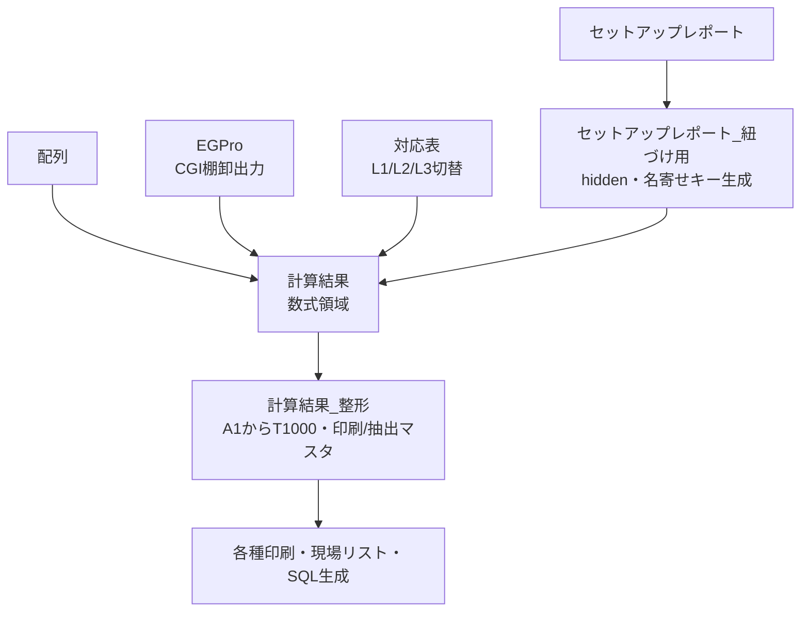

---

title: セットアップレポート計算機_仕様書
version: 1.0
status: WIP
updated: 2026-09-03
tags: [実装ライン, セットアップ, EGPro, VBA, 仕様書]

---
## 概要

#セットアップレポート計算機 は、パナソニック製実装機(NPM系)が出力するセットアップレポートと、社内在庫システムから取得した在庫データ(EGPro)を1つのExcelブック上で突き合わせ、実装ラインのセットアップ切替作業を支援するツールである。

セットアップ切替時に発生する一連の作業、すなわち
- レポート取り込み
- 現物確認
- シール貼り
- 手動入庫
- 棚戻し用SQL生成
までを、マクロ実行シート上の各ボタン1クリックで進められるようにしている。
目視では追いきれない突き合わせ作業を自動化し、どの部品のセットアップ情報が取れていないか、
スプライシング(テープ継ぎ)の切り替えに失敗している部品はどれか、倉庫外に出たまま所在不明になっているリールはどれかを洗い出す。
現場配布用リストや在庫DB更新用SQLの生成までを一貫して行う。

### ボタン操作の主な出力
①~⑤までは必要情報の入力。
- ①セットアップレポート入力
    - 実装機⇒PanaCIMでセットアップレポート取得([[固定テーブル棚卸方法]])する。
- ②EG-Pro在庫情報入力
    - EGProの現在時点での在庫を取得[Get_EG_Wherehouse.cgi]([nksv1359.ad.nkc.co.jp/cgi/qcd_DB/qcd_DB_Release/html/Get_EG_Wherehouse.cgi?ct=1788403102340](http://nksv1359.ad.nkc.co.jp/cgi/qcd_DB/qcd_DB_Release/html/Get_EG_Wherehouse.cgi?ct=1788403102340))する。
- ③配列情報入力
    - 「★固定マスタ」から生産品目ごとの情報を入力する。
- ④対応表入力
    - 同一ブック内を参照して必要情報を入力(配列上の記載とセットアップレポートの記載の仕方が異なるため。)
        - 例:L2NPM-1(配列)
             L2-NPM01(セットアップレポート)
- ⑤固定グループ名入力
    - 生産品目の情報を入力する(例:TEC56

| No  | 出力                 | 扱う問題                                      | 実行マクロ               |
| --- | ------------------ | ----------------------------------------- | ------------------- |
| 6   | セットアップ情報取得失敗リスト    | セットアップレポート上、部品情報が取れていない部品を洗い出す            | FaildSetUp          |
| 7   | スプライシング切り替え失敗部品リスト | 後側リールがあるのに前側がEG-Pro上在庫なし判定となり、切替失敗が疑われる部品 | FaildSplice         |
| 8   | スプライシング部品リスト       | 正常なスプライシング部品の一覧。現場でのシール貼りに使う              | PrintSplice         |
| 9   | 入庫バーコードシート         | 対象部品の入庫バーコードを印刷                           | ManualNyuko → Nyuko |
| EX1 | 所在不明リール            | EGProで貯蔵以外にあるリール、つまり倉庫外にあるものを抽出           | tana                |
| EX2 | 現場部品リスト            | 現場作業者に配布する部品一覧                            | GenbaList           |
| EX3 | 倉庫移動SQL            | 現場から棚に戻す部品の在庫DB更新SQL。人が確認して手動実行する         | idouSQL             |

## v1.0からv2.0への改修内容

VBAロジックの変更はない。差異はidouSQL(倉庫移動SQL生成)とそのヘルパーAppendLineに付随するコメントの整形だけで、生成されるSQLの実効内容と全マクロの処理フローはv1.0とv2.0で同一である。

完全一致で変更がなかったマクロは次のとおり。Utf8ToSjis、EG_Import、HAIRETSU_Import、SETUPREPORT_Import、FaildSetUp、FaildSplice、FaildSplice_OK、PrintSplice、ManualNyuko、tana、GenbaList、sasasa、Nyuko、Shukko、sasasda。オートフィルタ範囲、フィルタフィールド、列参照、印刷制御、バーコード配置もすべて同一である。

差分があったのはidouSQLとAppendLineのコメントのみで、いずれも動作に影響しない。AppendLine直前のコメント文言、SQL冒頭の見出し、各ブロックの見出し表現、SET XACT_ABORT ON行への注記の有無、COMMITとROLLBACKの案内文言が書き換わっている。生成される実SQL本体、
すなわちSELECT INTOによるバックアップ、BEGIN TRAN、UPDATE、IN句、@@ROWCOUNT表示、切り戻しUPDATEは完全に一致する。

## データフロー

## シート構成

| 表示名             | コードネーム  | 状態     | 役割                                                 |
| --------------- | ------- | ------ | -------------------------------------------------- |
| 計算結果            | Sheet1  | 表示     | 生の数式領域。未解決時はERROR:#N/Aを返す中間ワーク。計算結果_整形と同一の17列定義を持つ |
| 計算結果_整形         | Sheet7  | 表示     | 印刷およびリスト作成のマスタとなる整形済みテーブル。オートフィルタ対象でA1からT1000      |
| セットアップレポート_紐づけ用 | Sheet2  | hidden | 名寄せ用の作業シート。連結キーを生成し、右にレポート全33列を展開する                |
| セットアップレポート      | Sheet3  | 表示     | SETUPREPORT_Importで取り込む生データ。33列                    |
| 配列              | Sheet4  | 表示     | HAIRETSU_Importで取り込む固定テーブル配列                       |
| EGPro           | Sheet6  | 表示     | EG_Importで貼るCGI出力CSV。EGPro本体のCSVではない               |
| 対応表             | Sheet5  | 表示     | 配列名とレポート表記のマッピング。L1、L2、L3を切り替える                    |
| マクロ実行           | Sheet8  | 表示     | ユーザ操作用トップシート。ボタン12個                                |
| 印刷入力            | S1      | 表示     | バーコード印刷対象シリアルのバッファ。ボタン2個                           |
| 印刷              | S2      | 表示     | バーコード貼付および印刷用のレイアウトシート                             |
| 現場部品リスト         | Sheet10 | 表示     | GenbaListの出力先。idouSQLの入力元                          |
| 所在不明リール         | Sheet9  | 表示     | tanaの出力先。ステータスが貯蔵以外の抽出結果                           |

## ボタン配置(マクロ実行シート)

マクロ実行シートには12個のボタンが配置され、運用手順が上から順に並ぶ。

| 手順    | 配置(行,列) | ラベル                | 実行マクロ               | 見出し行                    |
| ----- | ------- | ------------------ | ------------------- | ----------------------- |
| 1     | (2, A)  | セットアップレポート入力       | SETUPREPORT_Import  | 行1                      |
| 2     | (6, A)  | EG-Pro在庫情報入力       | EG_Import           | 行5。D6に取得元CGIのURL        |
| 3     | (10, A) | 配列入力               | HAIRETSU_Import     | 行9                      |
| 4     | ボタン無し   | 対応表シートに手動貼付        | なし                  | 行13                     |
| 5     | ボタン無し   | 固定グループ名を手入力        | なし                  | 行15。行16に入力欄             |
| 6     | (19, A) | セットアップ情報取得失敗リスト    | FaildSetUp          | 行18                     |
| 7     | (25, A) | スプライシング切り替え失敗部品リスト | FaildSplice         | 行24                     |
| 7補    | ボタン無し   | 緊急退避用              | FaildSplice_OK      | K26に部品番号を入力             |
| 8     | (31, A) | スプライシング部品リスト       | PrintSplice         | 行30                     |
| 9     | (37, A) | 入庫バーコード作成          | ManualNyuko → Nyuko | 行36                     |
| EX1-1 | (43, A) | EG-Pro在庫情報入力       | EG_Import           | 行42                     |
| EX1-2 | (43, C) | 所在不明リスト作成          | tana                | 同上                      |
| EX2   | (49, A) | 現場部品リスト作成          | GenbaList           | 行48                     |
| EX3-1 | (57, A) | 現場部品リスト作成          | GenbaList           | 行53。A54に移動先、A55の初期値は201 |
| EX3-2 | (57, C) | 倉庫移動SQL作成          | idouSQL             | 同上                      |

ボタンを持たずVBAからのみ呼ばれる機能がある。FaildSplice_OKは緊急時にスプライシング解除をExcel上で反映するもので、VBEditorまたはAlt+F8から手動実行し、マクロ実行K26に対象部品番号を入力する必要がある。NyukoとShukkoはManualNyuko、FaildSplice、PrintSpliceからflag=Trueで呼ばれるほか、印刷入力シートに単独ボタンもある。Utf8ToSjis、AppendLine、sasasa、sasasdaは保守用である。

## ボタン配置(印刷入力シート S1)

| 配置(行,列) | ラベル | 実行マクロ | 動作 |
|---|---|---|---|
| (2, C) | 入庫用バーコード | Nyuko | S1のA列のシリアルを20件ずつS2に配置し、バーコードを生成して印刷 |
| (10, C) | 出庫用バーコード | Shukko | S1のA列のシリアルを40件ずつS2に配置し、バーコードを生成して印刷 |

NyukoとShukkoはflagがFalse、つまりS1ボタン経由だとプリンタ選択ダイアログと確認プロンプトを表示する。他マクロからflag=Trueで呼ばれるとダイアログを出さず即印刷する。Nyukoは1シリアルにつき元シリアルのバーコードと、先頭11文字を空白除去した派生バーコードの2段を印字し、1シートあたり20件を扱う。Shukkoはシリアルを2件ずつ1マスに配置し、1シートあたり40件を扱い、派生バーコードは作らない。

## 業務手順

1. セットアップレポート入力。UTF-8のCSVを取り込む。Utf8ToSjisでShift-JISへ変換した後、B列で現在のセットアップレポート行を探し、その行の次の行までを削除して本体を取り込む。
2. EG-Pro在庫情報入力。CGIのGet_EG_Tanaoroshi.cgiの出力CSVを取り込む。URLはマクロ実行D6にリンクがある。
3. 配列入力。1列目でフィーダーセットアップ行を探し、その行までを削除して取り込む。
4. 対応表入力。対応表シートに製品別(L1、L2、L3)のテンプレを手動でコピーする。
5. 固定グループ名入力。マクロ実行の行16に手入力する。
6. セットアップ情報取得失敗リスト。情報が引けなかった行を印刷し、現物確認して手順1からやり直す。
7. スプライシング切り替え失敗部品リスト。切り替え失敗部品を印刷し、Pana-CIM上でスプライシング解除を実施する。やむを得ない場合のみFaildSplice_OKで暫定処置する。
8. スプライシング部品リスト。通常のスプライシング部品を印刷し、現場でシール貼りをする。
9. 入庫バーコード作成。対象部品の入庫バーコードシートを印刷する。
10. 所在不明リスト。全部品の入庫処理が終わった後にEGProを最新化し、tanaで貯蔵以外を洗い出す。
11. 現場部品リスト作成。現場配布用の部品一覧を作る。
12. 倉庫移動SQL作成。現場部品リストを作り直した後、A55に移動先ロケーションコード(例として201)を入れてSQLを生成し、内容確認後にDBで手動実行する。

## 印刷および抽出マクロのフィルタ条件

全マクロで計算結果_整形のA1からT1000に対しオートフィルタを適用する。
共通条件は、Field=10(J列の部品番号)が空でないこと、Field=8(H列のテーブル番号)が14以外であること。

| マクロ | 適用フィルタ | 印刷時に非表示にする列 |
|---|---|---|
| FaildSetUp | F10が空以外、F12が空、F8が14以外 | L(12)、O(15)、S(19)、T(20) |
| FaildSplice | F10が空以外、F15が空以外、F19が◯、F8が14以外 | T(20) |
| PrintSplice | F10が空以外、F15が空以外、F8が14以外 | S(19) |
| ManualNyuko | F10が空以外、F12が空以外、F8が14以外 | なし |
| GenbaList | F10が空以外、F12が空以外、F8が14以外 | なし |

## 計算結果_整形シートの列構成と計算式

オートフィルタ範囲はA1からT1000。計算結果シート(Sheet1)も同一の1から17列の見出しを持つ。R、S、Tの3列は整形側で追加される判定列である。

| 列      | 列名                | 計算式または役割                                                                                                                                                  |
| ------ | ----------------- | --------------------------------------------------------------------------------------------------------------------------------------------------------- |
| A      | 配列_ゾーン名           | =配列!B2。配列シートのゾーン名をそのまま取り込む                                                                                                                                |
| B      | 数式_セットアップレポート変換   | =XLOOKUP(A2,対応表!A:A,対応表!B:B)。ゾーン名を対応表A列で照合し、B列の表記へ変換する                                                                                                    |
| C      | 配列_テーブル           | =配列!C2                                                                                                                                                    |
| D      | 配列_Z/PU番号         | =IF(配列!E2="",RIGHT(配列!D2&配列!E2,4)&"L",RIGHT(配列!D2&配列!E2,5))。D列とE列を連結し、E列が空なら末尾4文字にLを付け、値があれば末尾5文字を取る                                                      |
| E      | 数式_紐づけ用           | =IF(J2=0,,B2&D2&J2)。部品番号が0の枠は空。それ以外は変換後ゾーン名とZ/PU番号と部品番号を連結し照合キーを作る                                                                                        |
| F      | 取り付け部品シリアル_変換前    | =XLOOKUP(E2,セットアップレポート_紐づけ用!A:A,セットアップレポート_紐づけ用!J:J)。キーで紐づけ用シートのJ列を引く                                                                                     |
| G      | スプライシング部品シリアル_変換前 | =XLOOKUP(E2,セットアップレポート_紐づけ用!A:A,セットアップレポート_紐づけ用!V:V)。同じくV列を引く                                                                                             |
| H (8)  | テーブル番号            | =2*RIGHT(A2,1)-2+C2。ゾーン名の末尾一桁を2倍して2を引き、テーブルを足す。全印刷系で14以外のフィルタとGenbaList出力に使う                                                                              |
| I (9)  | Z                 | =IF(J2=0,"",IF(配列!E2="",マクロ実行!$A$16&" T"&H2&"-"&RIGHT(配列!D2&配列!E2,2),マクロ実行!$A$16&" T"&H2&"-"&RIGHT(配列!D2&配列!E2,3)))。固定グループ名にTとテーブル番号を続け、末尾Lの有無で2文字か3文字を取る |
| J (10) | 配列_部品             | =配列!F2。部品番号。全印刷系で空以外のフィルタ必須                                                                                                                               |
| K (11) | セットアップ情報取得日時      | =XLOOKUP(E2,セットアップレポート_紐づけ用!A:A,セットアップレポート_紐づけ用!R:R)。紐づけ用シートのR列を引く                                                                                        |
| L (12) | 取り付け部品シリアル        | =IF(LEN(F2)=13,"    "&F2,F2)。変換前が13文字ちょうどなら先頭に空白4つを足す。FaildSetUpは空条件、ManualNyukoとGenbaListは非空条件                                                           |
| M (13) | 取り付け部品在庫          | =XLOOKUP(L2,EGPro!A:A,EGPro!D:D)。整形後シリアルでEGProのD列を引く。GenbaListで使う                                                                                         |
| N (14) | 取り付け部品入庫時の数量      | =XLOOKUP(L2,EGPro!A:A,EGPro!C:C)。同じくC列を引く                                                                                                                 |
| O (15) | スプライシング部品シリアル     | =IF(LEN(G2)=13,"    "&G2,G2)。13文字なら空白4つを足す。FaildSplice、PrintSplice、ManualNyuko、GenbaListで使う                                                               |
| P (16) | スプライシング部品在庫       | =XLOOKUP(O2,EGPro!A:A,EGPro!D:D)。GenbaListで使う                                                                                                             |
| Q (17) | スプライシング部品入庫時の数量   | =XLOOKUP(O2,EGPro!A:A,EGPro!C:C)                                                                                                                          |
| R (18) | 取り付け部品が新品         | =IF(AND(M2<>"",M2=N2),"◯","")。取り付け部品在庫が空でなく、入庫時数量と一致すれば◯。在庫が入庫時のまま減っていない新品状態を捉える                                                                        |
| S (19) | 取り付け部品EG-Pro上在庫なし | =IF(M2="","◯","")。取り付け部品在庫が空、つまりEGProで在庫を引けなかったとき◯。FaildSpliceが◯を条件に抽出、PrintSpliceで印刷時に非表示                                                              |
| T (20) | スプライシング部品が使いかけ    | =IF(AND(P2<>"",P2<>Q2),"◯","")。スプライシング部品在庫が空でなく、入庫時数量と一致しないとき◯。在庫が入庫時から変動している使いかけ状態を捉える。FaildSetUpとFaildSpliceで印刷時に非表示                                 |

R列、S列、T列はいずれも条件を満たすと◯を返し、満たさなければ空欄にするフラグ列である。判定にはM列とN列の取り付け側、P列とQ列のスプライシング側の在庫と入庫時数量を使う。新品はM=N、使いかけはP≠Q、在庫なしはM空という三条件で整理でき、外部シート参照や絶対参照はなく、計算結果_整形の中で完結する。R列とT列は在庫が入庫時と一致するか変動したかで対になっている。

計算結果シートの数式は上流から順に依存する。配列とキー生成を土台に、対応表でゾーン名を変換し、末尾Lの有無が部品コード整形とテーブル名の分岐に効く。紐づけ用シートを照合先にシリアルと日時を引き、その値をシリアル桁揃えとEGPro参照で在庫と数量に展開する。名寄せシートに該当行がなければN/Aが返るため、計算結果にエラーが並ぶ。

計算結果_整形は計算結果の値を映して並べ直したもので、映す列はいずれもエラーと0を空欄に落とす同型の式を使う。例としてH列に対しては、=IF(IF(ISNA(計算結果!H1),"",計算結果!H1)=0,"",IF(ISNA(計算結果!H1),"",計算結果!H1))。同じ書き方でJ列、L列、O列を映す。エラーと0を空欄に落とすことで、印刷や抽出のフィルタが素直に効く。

## セットアップレポートシート(33列)

| No | 列名 |
|---|---|
| 1 | ライン名 |
| 2 | ゾーン名 |
| 3 | 設備名 |
| 4 | レーン |
| 5 | ステージ番号 |
| 6 | Z/PU番号 |
| 7 | スロット番号 |
| 8 | サブスロット番号 |
| 9 | 材料バーコード。FaildSplice_OKが21列目の値で上書きする |
| 10 | 部品番号 |
| 11 | 正規部品 |
| 12 | ロット番号 |
| 13 | ベンダー |
| 14 | UserData1 |
| 15 | フィーダーバーコード |
| 16 | 初期数量 |
| 17 | 部品取付時間 |
| 18 | 作業者 |
| 19 | スプライシング |
| 20 | メインリール |
| 21 | スプライシングリール。FaildSplice_OKの書き戻し元 |
| 22 | スプライシングリール2 |
| 23 | スプライシングリール3 |
| 24 | スプライシング作業者 |
| 25 | 部品クラス |
| 26 | MCID |
| 27 | 定期チェック状態 |
| 28 | 定期チェック失敗 |
| 29から32 | UserData2からUserData5 |
| 33 | 製造日 |

## セットアップレポート_紐づけ用シート(hidden)

名寄せ用の作業シート。数式表示版で確認できた構造は次のとおり。A列付近に対応表で変換したゾーン名(例としてL2-NPM07)、B列付近にZ/PUとスロット由来の連結キー(例として21001)、C列付近に部品シリアル(例として9000059949)を持ち、D列以降にセットアップレポート全33列を横展開する。これらを連結したキーで計算結果側のXLOOKUP照合が行われる。

## EGProシート(Get_EG_Tanaoroshi.cgi出力)

tanaマクロが列1から8を次のように扱う。

| No | 列名 |
|---|---|
| 1 | シリアル |
| 2 | 部品名 |
| 3 | 受入数 |
| 4 | 在庫 |
| 5 | ステータス。貯蔵以外が抽出対象 |
| 6 | ロケーション |
| 7 | 棚番 |
| 8 | 棚分類 |

## 対応表シート

A列とB列はマスタ本体で、現在アクティブな配列名とレポート表記の対応を持つ。D列からF列は製品別(L2、L3、L1)のテンプレで、切替時にA列とB列へ手動でコピーする。H列からJ列は取り込み済みデータ確認用の参考エリアである。

## 現場部品リストシート(GenbaList出力)

| No | 列名 | 転記元(計算結果_整形) |
|---|---|---|
| A | テーブル番号 | H(8) |
| B | Z | I(9) |
| C | 部品番号 | J(10) |
| D | シリアル。idouSQLの入力キー | 前側はL(12)、後側はO(15) |
| E | スプライシング | 前側は●、後側は●後側 |
| F | EGPro在庫 | 前側はM(13)、後側はP(16) |

1つの部品行から、前側のL列シリアルと後側のO列シリアルが両方あれば2行に展開される。

## 所在不明リールシート(tana出力)

EGProシートの列1から8のうち、ステータス(5列目)が貯蔵でない行を抽出する。見出しはtanaが上書きする。

## マクロ実行シートの入力セル

| セル | 用途 | 現在値 |
|---|---|---|
| A55 | idouSQL用の移動先ロケーションコード。数値必須 | 201 |
| K26 | FaildSplice_OK用の対象部品番号 | 空 |
| 行16 | 固定グループ名。手入力 | 空 |
| D6 | EG-Pro情報取得CGIへのハイパーリンク | http://nksv1359.ad.nkc.co.jp/cgi/qcd_DB/qcd_DB_Release/html/Get_EG_Tanaoroshi.cgi |

## idouSQLの生成SQL仕様(v1.0とv2.0共通)

入力はマクロ実行A55の移動先ロケーションと現場部品リストD2以降のシリアルである。A55が空または非数値ならエラーで中止する。
シリアルはシングルクォートを二重にエスケープしてIN句の形式で連結し、0件なら中止する。出力前に移動先と件数を確認ダイアログで表示する。

バックアップテーブルはT_在庫データ_移動前BK_yyyymmdd_hhnnssで、実行日時を付けて上書きを防ぐ。
更新カラムはロケーションコード、ステータスコード(M_ロケーションから参照)、ラインNoをNULL、設備NoをNULL、Z軸NoをNULL、更新日時をGETDATE。
安全策としてSET XACT_ABORT ONとBEGIN TRANで囲み、SELECT INTOでバックアップを取り、@@ROWCOUNTで件数を表示し、切り戻しSQLをコメントで付随する。

出力先は一時フォルダのtmp_sql.txtで、WScript.Shellで開く。DBへの自動実行はせず、人が中身を確認してから流す。COMMIT TRANは人手で追記する。対象DBはEGProKOHDEN-WarehouseのT_在庫データとEGProKOHDEN-MSTのM_ロケーションである。

## 前提参照設定(VBAプロジェクト)

Microsoft Scripting Runtime(FileSystemObject)、Microsoft ActiveX Data Objects(ADODB.Stream)、Microsoft BarCode Control(BARCODE.BarCodeCtrl.1)を参照する。

## 取り扱い時の注意

1. EGProシートに貼るのはCGIのGet_EG_Tanaoroshi.cgiの出力である。他ソースの棚卸CSVと混同しない。
2. SETUPREPORT_ImportのみUTF-8からShift-JISへの変換が入る。他のImportはExcel標準オープンである。
3. 計算結果_整形の範囲は全マクロでA1からT1000に固定されている。1000行を超える行は範囲外になる。
4. VBA内のSheet3参照(sasasa)はセットアップレポートシートを指す。コードネームがSheet3のためで、開発時にコードネームを変えると誤動作する。
5. セットアップレポート_紐づけ用はhiddenシートである。誤って表示や編集をしない。
6. BARCODE.BarCodeCtrl.1(Style=11)は32bit Officeを前提とする。64bit移行時に注意する。
7. FaildSplice_OKは業務例外用で通常運用では使わない。実行前にK26の入力が必須である。
8. idouSQLの生成SQLは自動実行しない設計である。COMMIT TRANは人手で追記する。

## 未確認および要ヒアリング事項

テーブル番号が14の行を除外する業務的な意味(治具または仮想テーブルの扱いか)は未確認である。R列、S列、T列の判定式は取得済みで、この項目は解消した。

**【2026-09-14追記・要注意】** R列(新品判定)とT列(使いかけ判定)はEGProシートのC列(受入数)・D列(在庫)をXLOOKUPで参照する。棚卸しではEGProシートにTanaoroshi形式を貼るが、この形式は在庫関連の数量を全件0で返す。したがって棚卸し中はM=N(0=0)が常に成立してR列が常に◯になり、P≠Q(0≠0は偽)が成立せずT列は常に空になる。棚卸し中のR列・T列の表示は信用しないこと。E列(紐づけキー)によるマッチング自体はEGProの数量列を参照しないため、GenbaListやidouSQLの対象特定(誰のどのシリアルを動かすか)には影響しない。影響するのはR・T列を見た目視判断だけである。