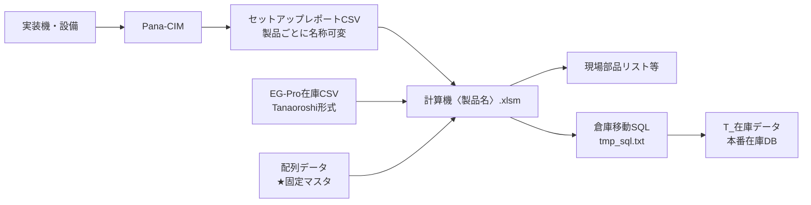

# 固定テーブル棚卸し 詳細設計・仕様書

> 本書は手順書の背景にある処理仕様・データ構造・安全策・判断記録を残す。作業手順そのものは [[固定テーブル棚卸し方法_手順書]] を参照する。旧「仕様書（仮）」の内容（データフロー図・R列/T列注意・自動化候補など）を2026-09-14に本書へ統合した。

## 0. 適用範囲（製品共通・製品可変の区別）

この文書は1つのシステム（セットアップレポート計算機とidouSQL）で複数製品の固定テーブル棚卸しを扱うための共通仕様と手順を記録する。処理ロジック・データフロー・マクロ・idouSQL・ロケーションコード・安全策は製品に依存しない。製品ごとに変わるのはファイル名やグループ名などの名称部分のみ。
本文では製品可変の箇所を `〈製品名〉` と表記する。作業対象の製品名（例: TEC5600）へ読み替える。
対応製品: AED / TEC1000 / TEC5600 / NKV / 送信機
| 区分 | 内容 | 表記 | 例 |
| --- | --- | --- | --- |
| 製品可変 | 計算機ファイル | セットアップレポート計算機〈製品名〉.xlsm | TEC5600 |
| 製品可変 | 不足部品リスト作成 | 不足部品リスト作成〈製品名〉_ver7.xlsm | TEC5600 |
| 製品可変 | セットアップレポートCSV | L2_〈製品名〉_セットアップレポート_日付.csv | TEC5600 |
| 製品可変 | 固定グループ名 | 〈製品名〉 | TEC5600 |
| 製品共通 | マクロ・ボタン配置 | ― | SETUPREPORT_Import 等 |
| 製品共通 | idouSQL・安全策 | ― | ― |
| 製品共通 | ロケーションコード | ― | 201/202/203/213 |
| 製品共通 | cgi使い分け | ― | Tanaoroshi/Wherehouse |

## 0-2. 製品・ライン・A55コード対応表

製品と製造ラインの対応、およびラインに対応するA55コードは次のとおり。idouSQLのA55へ入れる値はラインで決まる。
| 製品 | 製造ライン | 通常棚卸しのA55コード |
| --- | --- | --- |
| NKV | LINE1 | 201 |
| TEC5600 | LINE2 | 202 |
| TEC1000 | LINE2 | 202 |
| 送信機 | LINE2 | 202 |
| AED | LINE3 | 203 |

要確認（判断の境目として保留）:

*   LINE2の3製品（TEC5600・TEC1000・送信機）で202以外を使う条件。コードはライン単位で定めているが、製品によって別コードを使う場合があるとの指摘があり境目が未確定。
    
*   トレイ部品（テーブル14）を持つ製品と、213/203の切り分け条件。213は要確認（テーブル14との関係）。
    

## 1. 目的とスコープ

固定テーブル（実装機に載ったまま設備上に留まる部品）の現物とEG-Pro在庫データを突き合わせ、差異を解消する。目的は監査で部品の所在を説明できる状態を保つこと。処理は設備からPana-CIM、セットアップレポート、計算機〈製品名〉、EG-Proへと一方向に流れる。図解のdrawioを正とし、本文はその文章版として対応する。

## 2. システム構成とデータフロー

設備の実搭載状態がPana-CIMへ上がり、セットアップレポートとして出力される。計算機がこのレポートとEG-Pro在庫（Tanaoroshi形式）を突き合わせ、差異を洗い出し、現場配布用リストとDB更新用SQLを生成する。突き合わせは、セットアップレポートの材料バーコードとEG-Proのシリアル番号を1本ずつ結び、配列シートで位置を計算して行う。処理は全製品共通で、入力ファイルの名称だけが製品で変わる。

## 3. 使用ファイル・データ

使うファイルは、在庫を1行1リールで持つEGProWhereHouse.csv、設備が出すL2_〈製品名〉_セットアップレポート_日付.csv、取り込みと照合と現場部品リストと倉庫移動SQL作成を担うセットアップレポート計算機〈製品名〉.xlsm、不足部品リスト作成ツールの不足部品リスト作成〈製品名〉_ver7.xlsm、配列データ（★固定マスタ）である。
cgiの使い分けは製品共通。棚卸しはGet_EG_Tanaoroshi.cgiを使う。シリアル単位で所在を突き合わせるためで、URLはマクロ実行シートのD6にリンクがある。不足部品リストのB列更新はGet_EG_Wherehouse.cgiを使う。Tanaoroshi形式は在庫が全件0扱いになり、Wherehouseと取り違えると合計が壊れる。

## 4. 取り込みデータ仕様

*   セットアップレポート取り込み時にUTF-8からShift-JISへ自動変換される（取り込みマクロが実施）。取り込み後の列位置は、9列目=材料バーコード、10列目=部品番号、21列目=スプライシングリール。
    
*   EG-Proは棚卸し用のTanaoroshi形式で出す。Wherehouse形式はB列更新専用。
    
*   計算結果_整形のR列（新品判定）・T列（使いかけ判定）はEG-ProのC・D列（受入数・在庫）を参照するが、Tanaoroshi形式はこの2列を全件0で返す。棚卸し中はR列・T列の表示を信用しない。GenbaListやidouSQLが対象とするシリアルの特定には影響しない。
    
*   〈製品名〉の照合が在庫数列を参照していないかは、Tanaoroshi形式が在庫を全件0扱いにするため確認が要る（要確認）。
    

## 5. 倉庫移動SQL（idouSQL）仕様

### 5.1 処理内容

在庫数を変えず、シリアル列挙を条件にロケーションを付け替える処理。全製品共通。対象はT_在庫データ。ステータスはM_ロケーションから引き当て、ラインNoと設備NoとZ軸NoをNULLにし、更新日時をGETDATE()にする。出力はtmp_sql.txtへのテキストで、人が目視してから実行する運用を前提にしている。UPDATE本体のロジックは今回の改修でも変えていない。生成されるUPDATE結果は従来と同一。

### 5.2 安全策（今回の改修で追加）

*   移動先A55の空欄・非数値をチェックし、壊れたSQL生成を防ぐ。
    
*   シリアル内の引用符を二重化してからつなぎ、IN句の途中切れを防ぐ。
    
*   対象件数をカウントし、0件なら止める。
    
*   実行前に移動先と件数を表示し、押し間違いを防ぐ。
    
*   更新前状態を日時付きバックアップテーブルへSELECT INTOで退避し、切り戻し原本を確保する。
    
*   SET XACT_ABORT ON と BEGIN TRAN で囲む。UPDATE後に更新件数と@@TRANCOUNTを表示し、COMMIT/ROLLBACKはコメントとして出力し担当者が選ぶ。末尾に切り戻しSQLをコメントで添える。
    
*   SQL組み立ては行継続からAppendLineへ変更。ファイル出力は固定番号をやめ、パスを引用符で囲む。
    

### 5.3 トランザクション運用

更新件数を表示するところまで一度で実行し、想定と合えばCOMMITの行だけ、合わなければROLLBACKの行だけを実行する。確定後に@@TRANCOUNTが0であることを確認してウィンドウを閉じる。途中でエラーが出れば全体が自動で巻き戻る。確定後もバックアップから切り戻せる。

### 5.4 実行環境の制約

バックアップ取得のSELECT INTOは管理者権限を前提とする。権限のない環境へ横展開する場合は、あらかじめ用意した固定テーブルへINSERTする方式へ差し替える必要がある。

## 6. 移動先コード対応表（製品共通・ラインで決まる）

idouSQLを流すとき、マクロ実行シートのA55へ、その回に処理するラインのコードを選んで入れる。製品が変わってもラインで決まる。根拠は [[倉庫コード・棚卸対象_確定事項]]（2026-09-11 松井さん確認・確定）。製品との対応は第0-2章を参照する。
| 処理対象 | 移動先コード | 確定状況 | 確認者 | 更新日 |
| --- | --- | --- | --- | --- |
| 1ラインの棚卸（NKV） | 201 | 確定 | 松井さん | 2026-09-11 |
| 2ラインの棚卸（TEC5600/TEC1000/送信機） | 202 | 確定 | 松井さん | 2026-09-11 |
| 3ラインの棚卸（AED） | 203 | 確定 | 松井さん | 2026-09-11 |
| 3ライントレイ部品 | 213 | 要確認（テーブル14との関係） | 松井さん | 2026-09-11 |

*   208は実マスタに存在しない廃止コード（v2記述時点で資料に混在していた）。使わない。
    
*   777（装置取付_棚卸）は倉庫コードマスタに存在するが、固定テーブル棚卸しのA55には使わない（2026-09-14 本人確認済み）。用途が生じた場合は [[倉庫コード・棚卸対象_確定事項]] を参照する。
    
*   過去に棚卸し用倉庫を202固定と記述していたが、実マスタはライン別のため201/202/203で管理する形に改めた。コードの管理元はEG-Proのマスター管理にあたる。
    

## 7. 実行前に運用で担保すること

*   作業する製品の計算機ファイル・レポートCSV・固定グループ名を〈製品名〉へ正しく読み替える。前回製品のファイルを開いたまま進めない。
    
*   idouSQLの前に現場部品リストを作り直し、D列に実シリアルが並ぶのを目視する（D2に見出しのシリアルという文字が残ると0件判定を通過し、見出し1件だけでSQLが流れる不具合が実際に出ている）。
    
*   WHERE句はシリアル列挙のみで現在ロケーションを条件にしない。対象外シリアルが混じるとそのまま書き換わる。対象の正しさを実行前に確認する。
    
*   A55の移動先コードは第0-2章と第6章の対応表から選ぶ。値の取り違えは正しい件数を誤った倉庫へ移す。
    
*   idouSQLは管理権限のあるPCで実行する。
    

## 8. 確定した運用（聞き取り済み）

*   対応製品はAED・TEC1000・TEC5600・NKV・送信機。同一システムで名称のみ差し替えて運用する（2026-09-14 本人確認）。
    
*   製品と製造ラインの対応は、NKV=LINE1、TEC5600/TEC1000/送信機=LINE2、AED=LINE3（2026-09-14 本人確認）。
    
*   テーブル番号14はトレイ部品。全数カウントの対象で、いったん全部を倉庫へ戻す。設備に部品が付いた状態では棚卸しをしない。マクロが14をフィルタで除外している挙動もこの運用と対応する。
    
*   所在不明リールの抽出は、置き場所で判断する棚基準から、モノの状態で判断する貯蔵以外基準へ変わった。二ライン倉庫・三ライン倉庫は貯蔵に含む。旧新でほぼ同じ範囲を指す。
    
*   ロケーションコードは対応表で確定（201/202/203/213）。
    
*   idouSQLの実行環境は管理権限のあるPC。この前提は当面変わらない。
    

## 9. 未確定・要確認（本番前に埋める）

*   LINE2の3製品（TEC5600・TEC1000・送信機）で202以外を使う条件。
    
*   製品ごとの実ファイル名が第0章の命名規則どおりか（AED/TEC1000/NKV/送信機で確認）。命名が異なる製品があれば表へ追記する。
    
*   213（3ライントレイ倉庫）とテーブル14の関係。A55に使ってよいか。
    
*   テーブル番号14を現場部品リストから外す業務上の根拠資料。
    
*   計算機の20列目・A〜G列、配列シートA〜E列の正式定義（一次資料が見つからず実データから推定）。
    
*   EG-Pro在庫CSVの3・4・11列目の見出し（対応づけに推定が混じる）。
    
*   移動先コード一覧の所在・管理者・採番ルール（採番は発注番号順でなく、入荷順＝ラベル貼付順との情報あり。関口さんか部品管理へ確認）。
    
*   所在不明リール抽出条件をロケーション基準からステータス基準へ変えた理由と決定者（現行方針が正しい前提で進める。監査説明リスクは残る）。
    
*   セットアップ情報が取れない部品の手動処理（文書化されておらず属人化）。
    
*   FaildSplice_OKの使用条件・実行者・承認者・事後確認者・記録方法・K26入力形式（未定。使う場合は運用ルールを事前取り決め）。
    
*   バックアップテーブルの保管期間・削除ルール、FaildSplice_OKの実行ログ保存ルール。
    
*   0確認手順の文書化（属人化。誰でも実施できる状態にする）。
    
*   承認者・所要時間・実行時間帯・OS/ブラウザ等の実行環境（今回の実施で確認して確定する）。
    

## 10. 将来の自動化候補

*   GenbaListのD2見出し残りによる0件流れの検知を、目視でなく自動チェックにする。
    
*   A55コードの取り違え防止（ライン選択のドロップダウン化）。
    
*   製品選択に応じて計算機ファイル・レポートCSV名を自動で切り替える仕組み（読み替えミスの防止）。
    

## 用語

固定テーブルは実装機に載ったままの部品。EG-Proは在庫管理システム。Pana-CIMは設備の生産管理システムでセットアップレポートの出力元。セットアップレポートは設備の現セットアップ状態を示すCSV。スプライシングはリールをつなぎ合わせる作業。棚卸し用倉庫は棚卸し時にまとめて移すロケーションで、コードはラインごとに対応表で定める。
図解はdrawioを正とし、pptxとdrawioで差異があればdrawioを優先する。ただしdrawioがA55を202と直書きしている箇所は古い記述として扱い、移動先コードは対応表の値を使う。本文は現在判明している情報を記録したもので、未確定項目は未確認と明記している。
