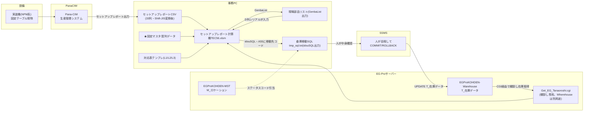
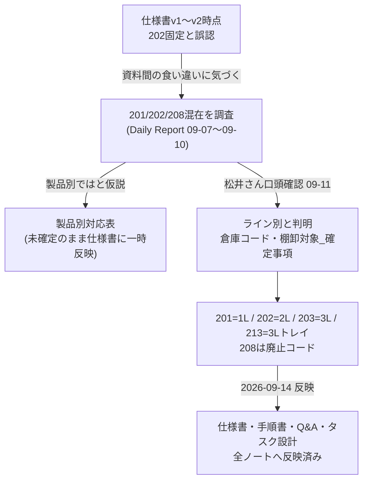

[[07-1_棚卸/固定テーブル棚卸し_詳細設計・仕様書]] / [[固定テーブル棚卸し方法_手順書]] / [[セットアップレポート計算機]] / [[07-1_棚卸/倉庫コード・棚卸対象_確定事項]]

この文書は「何が、どのファイル・マクロを経由して、どこへ流れるか」を1枚で追えるようにするための関係性マップ。各リンクの詳細な仕様は、対応する既存ノートへ委譲する(この文書では概要と参照先だけを持つ)。

---

## 全体データフロー(システム間)

## リンクごとのノート

| # | 何から何へ | 中継するファイル・仕組み | 根拠・詳細を持つノート |
|---|---|---|---|
| 1 | 実装機 → Pana-CIM | 設備の実搭載状態が自動反映(約10分) | [[固定テーブル棚卸し方法_手順書]] 手順1・2 |
| 2 | Pana-CIM → セットアップレポートCSV | eplantview、材料照合レポート | [[固定テーブル棚卸し方法_手順書]] 手順2 |
| 3 | EG-Proサーバー → 計算機 | Get_EG_Tanaoroshi.cgi(棚卸し専用) | [[セットアップレポート計算機]] 「EGProシート」節。**Get_EG_Wherehouse.cgiと混同しないこと** |
| 4 | セットアップレポートCSV/配列/対応表 → 計算機内部 | SETUPREPORT_Import・HAIRETSU_Import・対応表手動貼付 | [[セットアップレポート計算機]] 「データフロー」「シート構成」節 |
| 5 | 計算機内部の数式連鎖 | 配列→計算結果→計算結果_整形(A〜T列) | [[セットアップレポート計算機]] 「計算結果_整形シートの列構成と計算式」節 |
| 6 | 計算機 → 現場部品リスト | GenbaListマクロ、テーブル番号14を除外 | [[セットアップレポート計算機]] 「現場部品リストシート」節 |
| 7 | 現場部品リスト → 倉庫移動SQL | idouSQLマクロ、A55の移動先コードを使用 | [[セットアップレポート計算機]] 「idouSQLの生成SQL仕様」節、コード値は[[07-1_棚卸/倉庫コード・棚卸対象_確定事項]] |
| 8 | 倉庫移動SQL → EG-Proサーバー | SSMSで人が目視しCOMMIT/ROLLBACK選択 | [[固定テーブル棚卸し方法_手順書]] 手順9 |
| 9 | EG-Proサーバー → 所在不明リスト | tanaマクロ、ステータスが貯蔵以外を抽出 | [[セットアップレポート計算機]] 「所在不明リールシート」節 |

## 移動先コードの決定関係(何が何を確定させたか)

## ドキュメントマップ(どのノートが何を持つか)

同じ話題を複数ノートが扱っているため、迷ったらこの表で正本を確認する。

| ノート | 役割 | 正本性 |
|---|---|---|
| [[07-1_棚卸/固定テーブル棚卸し_詳細設計・仕様書]] | 作業手順とマクロ仕様の文章版、未確定事項の一覧 | 正本(仕様) |
| [[固定テーブル棚卸し方法_手順書]] | 現場で実際に上から辿る手順書。ボタン操作の早見表つき | 正本(手順) |
| 本ノート | マクロ・データ・システム間の関係性の見取り図 | 正本(関係性) |
| [[セットアップレポート計算機]] | マクロ本体の技術仕様(シート・列・数式・ボタン配置) | 正本(マクロ技術仕様) |
| [[07-1_棚卸/倉庫コード・棚卸対象_確定事項]] | 移動先コードと棚卸対象ロケーションの確定値 | 正本(コード値) |
| [[固定テーブル棚卸し作業_全般タスク設計]] | 全工程の優先順位づけと着手順の考え方 | 参考(設計メモ) |
| [[セットアップレポート計算マクロについて・想定質問]] | Q&A形式の運用上の注意点 | 参考(Q&A) |
| [[セットアップレポート-テーブル設計書]] | セットアップレポートCSV単体の列定義 | 参考(入力データ仕様) |

## 未確定のまま残る関係性

- テーブル番号14がなぜGenbaListの抽出から除外される業務ルールなのか、根拠資料が無い
- 213(3ライントレイ倉庫)とテーブル14の関係
- EGProシートの11列目が計算機のどの処理にも使われていない理由(未使用か、未確認か)
- FaildSplice_OKがK26入力からセットアップレポートシートのどの列を書き換えるかは判明済み(21列目)だが、承認フローは未整備

関連: [[00_Todo]]
