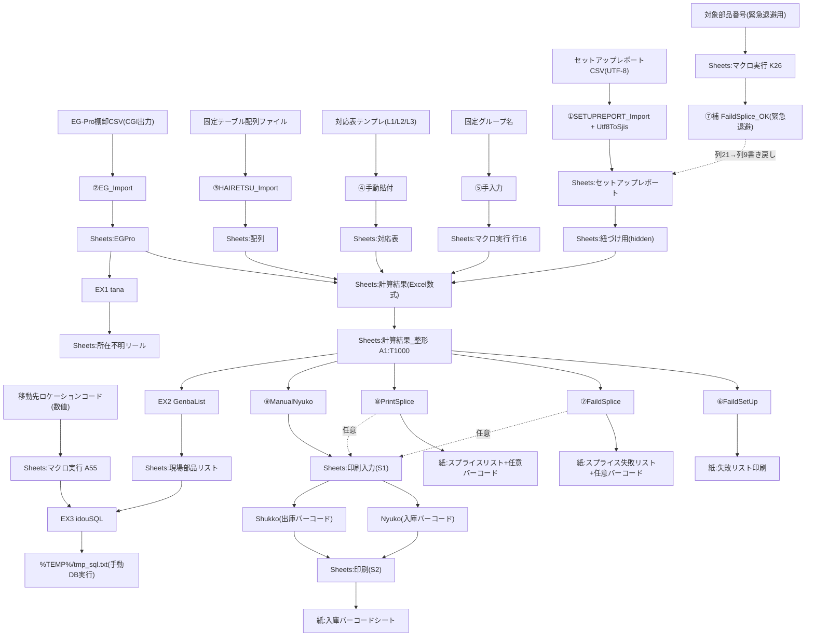

## 入力CSVの確認結果（2026-09-29）

元PDF『固定テーブル　棚卸し方法』スライド5は、Get_EG_Tanaoroshi.cgi出力を「EG-Pro在庫情報入力」へ読み込むと指定している。これはカウント前の在庫入力である。

今回の棚卸用CSVは見出し付き8列で、在庫数4列目、ステータス名称5列目、ロケーション名称6列目。0確認6,997行を含む。WhereHouse11列版とは列位置が異なる。棚卸用にないのは発注番号・入荷日時・最終更新日時であり、「0確認がない」ことではない。

詳細は [[固定テーブル棚卸し_詳細設計・仕様書]] の2026-09-29訂正を参照。CSVに関する本文と矛盾する場合は本補足を優先し、各マクロの実装を今回再検証したとは扱わない。

---

# セットアップレポート計算機 v2.0 仕様メモ

## 1. このツールで何ができるのか / 何をするためのものか

パナソニック製実装機（NPM系）の「セットアップレポート」と、社内在庫システムから出力した在庫データを Excel 上で突き合わせ、以下を1つのブックで完結させるためのツール [4]。

- セットアップレポート・在庫・配列（ライン設備配置）情報の取り込み
- セットアップ情報が取得できていない部品の抽出・印刷 [2]
- スプライシング（テープ継ぎ）の切り替え失敗部品の抽出・印刷 [2]
- 通常のスプライシング部品リストの印刷 [2]
- 各部品の入庫バーコード／出庫バーコードのシート印刷 [3]
- 「貯蔵」以外の場所にある所在不明リールの抽出 [2]
- 現場配布用部品リストの生成 [2]
- 現場部品リストの対象を、EGPro DB の指定ロケーションへ移動するための SQL 生成（実行は人手）[2]

セットアップ切替時の「レポート → 現物確認 → シール貼り → 手動入庫 → 棚戻し（SQL）」までの1サイクルを、Excel の各ボタン1クリックで進められる支援ツール。

---

## 2. 変更履歴

### v2.0 (2026-09-01時点) 確定事項
- ボタン配置（マクロ実行シート12個 / 印刷入力シート2個）を実ファイルから確定 [4]
- シート構成12枚を確定（コードネームと表示名の対応も確定）
- 隠しシート `セットアップレポート_紐づけ用` (Sheet2) の存在を確認
- `計算結果_整形` シートの列R/S/T（18-20列目）の正式名称を確定 [4]
  - R = 「取り付け部品が新品」
  - S = 「取り付け部品EG-Pro上在庫なし」
  - T = 「スプライシング部品が使いかけ」
- `EGPro` シートは EGPro本体CSV ではなく、社内CGI `Get_EG_Tanaoroshi.cgi` の出力を貼る仕様 [4]
- 移動先ロケーション初期値: `マクロ実行!A55 = 201` [4]
- VBA `Sheet3` 参照 (`sasasa`) が指すのは「セットアップレポート」シート（コードネーム由来）[3]

### 次回以降で更新すべき事項（テンプレ）
- 追加/削除/リネームされたボタンとその配置（行,列）
- 追加/削除されたシート、コードネームの変更
- `計算結果_整形` の列構成の追加・変更
- `対応表` シートに追加された機種（現状 L1/L2/L3）[4]
- 移動先ロケーション初期値の変更
- ハードコード範囲（`$A$1:$T$1000`）の拡張 [2]

---

## 3. シート構成

| 表示名 | コードネーム | 状態 | 役割 |
|---|---|---|---|
| 計算結果 | Sheet1 | 表示 | 生の計算式領域（`ERROR:#N/A` が大量）。中間ワーク [4] |
| 計算結果_整形 | Sheet7 | 表示 | 印刷/リスト作成のマスタとなる整形済みテーブル。オートフィルタ対象 [4] |
| セットアップレポート_紐づけ用 | Sheet2 | hidden | 名寄せ・変換用の作業シート（内部用） |
| セットアップレポート | Sheet3 | 表示 | `SETUPREPORT_Import` で取り込む生データ [2] |
| 配列 | Sheet4 | 表示 | `HAIRETSU_Import` で取り込む固定テーブル配列 [2] |
| EGPro | Sheet6 | 表示 | `EG_Import` で貼るCGI出力CSV（EGPro本体CSVではない）[4] |
| 対応表 | Sheet5 | 表示 | 配列名⇔レポート表記のマッピング（L1/L2/L3切替）[4] |
| マクロ実行 | Sheet8 | 表示 | ユーザ操作用トップシート。ボタン12個 [4] |
| 印刷入力 | S1 | 表示 | バーコード印刷対象シリアルのバッファ。ボタン2個 [4] |
| 印刷 | S2 | 表示 | バーコード貼付/印刷用レイアウトシート [3] |
| 現場部品リスト | Sheet10 | 表示 | `GenbaList` の出力先。`idouSQL` の入力元 [2] |
| 所在不明リール | Sheet9 | 表示 | `tana` の出力先。ステータス「貯蔵」以外の抽出結果 [2] |

---

## 4. 機能一覧（簡略版）

| # | 機能名（マクロ） | 何ができるか | 入力 | 出力 |
|---|---|---|---|---|
| ① | セットアップレポート入力（`SETUPREPORT_Import`） | 装置の現状データを取り込む | UTF-8のセットアップレポートCSV | `セットアップレポート`シート（SJIS変換込み）[2] |
| ② | EG-Pro在庫情報入力（`EG_Import`） | 倉庫の現在庫を取り込む | CGI出力の棚卸CSV | `EGPro`シート [2] |
| ③ | 配列入力（`HAIRETSU_Import`） | 設備配置マスタを取り込む | 固定テーブル配列ファイル | `配列`シート [2] |
| ④ | 対応表入力（手動） | 機種（L1/L2/L3）切替 | テンプレをコピペ | `対応表`シートA-B列 [4] |
| ⑤ | 固定グループ名入力（手動） | 今回の固定グループ名を指定 | 手入力 | `マクロ実行`シート行16 [4] |
| ⑥ | セットアップ情報取得失敗リスト（`FaildSetUp`） | 紐づけできなかった部品を洗い出す | ①②③の結果 | 該当行を印刷 [2] |
| ⑦ | スプライシング切り替え失敗リスト（`FaildSplice`） | 後側リールがあるのに前側が在庫なし判定＝切替失敗を検出 | 同上 | 印刷＋任意で出庫バーコード [2] |
| ⑦補 | スプライシング解除の暫定処置（`FaildSplice_OK`）※ボタン無し | レポート再出力できない時、Excel上で解除相当に書き換え | `K26`に部品番号 | セットアップレポート列21→列9に書き戻し [2] |
| ⑧ | スプライシング部品リスト（`PrintSplice`） | 正常にスプライシングされている部品を一覧化 | 同上 | 印刷＋任意で出庫バーコード [2] |
| ⑨ | 入庫バーコード作成（`ManualNyuko`） | 対象部品の入庫用バーコードシートを刷る | 同上 | 1枚に20件のバーコードシート [2][3] |
| EX1 | 所在不明リスト（`tana`） | 「貯蔵」以外にあるリールを洗い出す | `EGPro`シート | `所在不明リール`シート [2] |
| EX2 | 現場部品リスト作成（`GenbaList`） | 現場配布用の部品一覧を作る | `計算結果_整形` | `現場部品リスト`シート [2] |
| EX3 | 倉庫移動SQL作成（`idouSQL`） | 現場から棚に戻すDB更新SQLを生成（実行は人手） | `現場部品リスト`＋`A55`(移動先) | `%TEMP%\tmp_sql.txt` [2] |

### 補助機能（印刷入力シートに単独ボタンあり）
| 機能 | 何ができるか |
|---|---|
| 入庫用バーコード（`Nyuko`） | S1シートA列のシリアルを、20件/枚のバーコードシートに印刷 [3] |
| 出庫用バーコード（`Shukko`） | S1シートA列のシリアルを、40件/枚のバーコードシートに印刷 [3] |

### 目的別まとめ
- 異常検知したい → ⑥（情報欠落）／⑦（スプライシング切替失敗）／EX1（所在不明）
- 現場に紙を渡したい → ⑧（スプライスリスト）／EX2（部品リスト）
- バーコードシールを出したい → ⑨（入庫）／Shukkoボタン（出庫）
- DBを更新したい → EX3（SQL生成→人が実行）

---

## 5. ボタン配置（マクロ実行シート）

| 手順No | 位置(行,列) | ラベル | 実行マクロ | 見出し行 |
|---|---|---|---|---|
| ① | (2, A) | セットアップレポート入力 | `SETUPREPORT_Import` [2] | 行1「①セットアップレポート入力」[4] |
| ② | (6, A) | EG-Pro在庫情報入力 | `EG_Import` [2] | 行5「②EG-Pro在庫情報入力」/ D6 に取得元CGIのURL [4] |
| ③ | (10, A) | 配列入力 | `HAIRETSU_Import` [2] | 行9「③配列情報入力」[4] |
| ④ | ボタン無し | — | （対応表シートに手動貼付） | 行13「④対応表入力」[4] |
| ⑤ | ボタン無し | — | （固定グループ名を手入力） | 行15「⑤↓固定グループ名入力」/ 行16 に入力欄 [4] |
| ⑥ | (19, A) | セットアップ情報取得失敗リスト | `FaildSetUp` [2] | 行18「⑥セットアップ情報取得失敗リスト」[4] |
| ⑦ | (25, A) | スプライシング切り替え失敗部品リスト | `FaildSplice` [2] | 行24「⑦スプライシング切り替え失敗部品リスト印刷」[4] |
| ⑦補 | ボタン無し | — | `FaildSplice_OK`（緊急退避用）[2] | 参照セル: マクロ実行!K26 |
| ⑧ | (31, A) | スプライシング部品リスト | `PrintSplice` [2] | 行30「⑧スプライシング部品リスト印刷」[4] |
| ⑨ | (37, A) | 入庫バーコード作成 | `ManualNyuko` → `Nyuko` [2][3] | 行36「⑨手動入庫処理バーコード作成」[4] |
| EX1① | (43, A) | ①EG-Pro在庫情報入力 | `EG_Import` [2] | 行42「EX)所在不明リスト作成…」[4] |
| EX1② | (43, C) | ②所在不明リスト作成 | `tana` [2] | 同上 |
| EX2 | (49, A) | 現場部品リスト作成 | `GenbaList` [2] | 行48「EX)現場部品リスト作成」[4] |
| EX3① | (57, A) | ①現場部品リスト作成 | `GenbaList` [2] | 行53「EX)倉庫移動SQL作成」/ A54「移動先↓」/ A55 = 201（初期値）[4] |
| EX3② | (57, C) | ②倉庫移動SQL作成 | `idouSQL` [2] | 同上 |

### ボタンが存在しない機能（VBA からのみ呼ばれる）
- `FaildSplice_OK` … 緊急時にスプライシング解除相当をExcel上で反映。VBEditor か Alt+F8 から手動実行。`マクロ実行!K26` に対象部品番号を入力する必要あり [2]
- `Nyuko` / `Shukko` … `ManualNyuko` / `FaildSplice` / `PrintSplice` から呼ばれる [2]。印刷入力(S1)シート上に単独ボタンもあり [4]
- `Utf8ToSjis` [2], `AppendLine` [2], `sasasa` / `sasasda` [3] … 内部ユーティリティ／保守用

### ボタン配置（印刷入力シート = S1）
| 位置(行,列) | ラベル | 実行マクロ | 動作 |
|---|---|---|---|
| (2, C) | 入庫用バーコード | `Nyuko` | S1 A列のシリアルを 20件/シートで S2 に配置、バーコード生成、印刷 [3] |
| (10, C) | 出庫用バーコード | `Shukko` | S1 A列のシリアルを 40件/シートで S2 に配置、バーコード生成、印刷 [3] |

`Nyuko` / `Shukko` は `flag = False`（S1ボタン経由）だとプリンタ選択ダイアログ→確認プロンプトを表示。他マクロから `flag = True` で呼ばれると即印刷 [3]

---

## 6. 標準業務フロー（使う順番）

1. ① セットアップレポート入力 — UTF-8 CSV を取り込む（SJIS変換）[2]
2. ② EG-Pro在庫情報入力 — CGI `Get_EG_Tanaoroshi.cgi` の出力CSVを取り込む。URLはマクロ実行!D6 [2][4]
3. ③ 配列入力 — 「フィーダーセットアップ」以降を取り込む [2]
4. ④ 対応表入力 — L1/L2/L3 テンプレをコピペ（手動）[4]
5. ⑤ 固定グループ名入力 — マクロ実行!行16 に手入力 [4]
6. ⑥ セットアップ情報取得失敗リスト — 出た場合は現物確認して①からやり直す [2][4]
7. ⑦ スプライシング切り替え失敗部品リスト — Pana-CIM 上でスプライシング解除実施。やむを得ない場合のみ `FaildSplice_OK` [2][4]
8. ⑧ スプライシング部品リスト — 現場でシール貼り [2][4]
9. ⑨ 入庫バーコード作成 — 対象部品の入庫バーコードシートを印刷 [2]
10. EX1 所在不明リスト — 全部品の入庫処理後、EGPro最新化 → `tana` で貯蔵以外を洗い出し [2][4]
11. EX2 現場部品リスト作成 — 現場配布用の部品一覧を作成 [2]
12. EX3 倉庫移動SQL作成 — A55 に移動先ロケーションコード → SQL生成 → 内容確認後 DB で手動実行 [2][4]

---

## 7. データフロー全体像

---

## 8. 各シートの列構成

### 8.1 `計算結果_整形` シート（オートフィルタ範囲: A1:T1000）[2]
| 列 | 列名 | VBAから参照される場面 |
|---:|---|---|
| A | 配列_ゾーン名 [4] | — |
| B | 数式_セットアップレポート変換 [4] | — |
| C | 配列_テーブル [4] | — |
| D | 配列_Z/PU番号 [4] | — |
| E | 数式_紐づけ用 [4] | — |
| F | 取り付け部品シリアル_変換前 [4] | — |
| G | スプライシング部品シリアル_変換前 [4] | — |
| H (=8) | テーブル番号 [4] | 全印刷系マクロで `<>14` フィルタ、GenbaList出力 [2] |
| I (=9) | Z [4] | GenbaList出力 [2] |
| J (=10) | 配列_部品（＝部品番号）[4] | 全印刷系マクロで `<>""` フィルタ必須 [2] |
| K (=11) | セットアップ情報取得日時 [4] | — |
| L (=12) | 取り付け部品シリアル [4] | ManualNyuko/GenbaList/バーコード印刷対象 [2] |
| M (=13) | 取り付け部品在庫 [4] | GenbaList [2] |
| N (=14) | 取り付け部品入庫時の数量 [4] | — |
| O (=15) | スプライシング部品シリアル [4] | FaildSplice/PrintSplice/ManualNyuko/GenbaList [2] |
| P (=16) | スプライシング部品在庫 [4] | GenbaList [2] |
| Q (=17) | スプライシング部品入庫時の数量 [4] | — |
| R (=18) | 取り付け部品が新品 [4] | — |
| S (=19) | 取り付け部品EG-Pro上在庫なし [4] | FaildSplice で `= ◯` 条件、PrintSplice で非表示 [2] |
| T (=20) | スプライシング部品が使いかけ [4] | FaildSetUp/FaildSplice で印刷時に非表示 [2] |

### 8.2 `セットアップレポート` シート（33列）[4]
| # | 列名 |
|---:|---|
| 1 | ライン名 |
| 2 | ゾーン名 |
| 3 | 設備名 |
| 4 | レーン |
| 5 | ステージ番号 |
| 6 | Z/PU番号 |
| 7 | スロット番号 |
| 8 | サブスロット番号 |
| 9 | 材料バーコード ← `FaildSplice_OK` が21列目の値で上書き [2] |
| 10 | 部品番号 |
| 11 | 正規部品 |
| 12 | ロット番号 |
| 13 | ベンダー |
| 14 | UserData1 |
| 15 | フィーダーバーコード |
| 16 | 初期数量 |
| 17 | 部品取付時間 |
| 18 | 作業者 |
| 19 | スプライシング |
| 20 | メインリール |
| 21 | スプライシングリール ← `FaildSplice_OK` の書き戻し元 [2] |
| 22 | スプライシングリール2 |
| 23 | スプライシングリール3 |
| 24 | スプライシング作業者 |
| 25 | 部品クラス |
| 26 | MCID |
| 27 | 定期チェック状態 |
| 28 | 定期チェック失敗 |
| 29-32 | UserData2〜5 |
| 33 | 製造日 |

### 8.3 `EGPro` シート（`Get_EG_Tanaoroshi.cgi` 出力を貼る）
`tana` マクロが列1〜8を次のように扱う（＝CGI出力のCSV仕様）[2]:

| # | 列名 |
|---:|---|
| 1 | シリアル |
| 2 | 部品名 |
| 3 | 受入数 |
| 4 | 在庫 |
| 5 | ステータス（「貯蔵」以外が抽出対象） |
| 6 | ロケーション |
| 7 | 棚番 |
| 8 | 棚分類 |

### 8.4 `対応表` シート [4]
- A-B列: マスタ本体（現在アクティブな配列名 ⇔ セットアップレポート表記）
- D-F列: L2/L3/L1 用テンプレ（切替時に A-B列へ手動コピペ）
- H-J列: 現在の取り込みデータ確認用の参考エリア

### 8.5 `現場部品リスト` シート [2][4]
| # | 列名 |
|---:|---|
| A | テーブル番号 |
| B | Z |
| C | 部品番号 |
| D | シリアル ← `idouSQL` の入力キー |
| E | スプライシング（`●` または `●後側`） |
| F | EGPro在庫 |

### 8.6 `所在不明リール` シート
`EGPro` シートの列1〜8をそのままコピー（見出しは `tana` が上書き）[2]

### 8.7 `印刷入力` (S1) / `印刷` (S2) シート
- S1 A列: `Nyuko`/`Shukko` に流し込むシリアルリスト [3]
- S2: バーコードコントロール（`BARCODE.BarCodeCtrl.1`, Style=11）を貼り付けて印刷するレイアウト面 [3]

---

## 9. マクロ実行シートの入力セル一覧

| セル | 用途 | 現在値 |
|---|---|---|
| A55 | `idouSQL` 用の移動先ロケーションコード（数値必須）[2] | 201 [4] |
| K26 | `FaildSplice_OK` 用の対象部品番号 [2] | 空 |
| 行16 | ⑤固定グループ名（手入力）[4] | 空 |
| D6 | ②EG-Pro情報取得CGIへのハイパーリンク [4] | `http://nksv1359.ad.nkc.co.jp/cgi/qcd_DB/qcd_DB_Release/html/Get_EG_Tanaoroshi.cgi` |

---

## 10. `idouSQL` の生成SQL仕様 [2]

- 入力: `マクロ実行!A55`（移動先ロケーション、数値必須）と `現場部品リスト!D2:` のシリアル
- バックアップテーブル: `T_在庫データ_移動前BK_yyyymmdd_hhnnss`
- 更新カラム: `ロケーションコード`, `ステータスコード`（`M_ロケーション`から参照）, `ラインNo=NULL`, `設備No=NULL`, `Z軸No=NULL`, `更新日時=GETDATE()`
- 安全策: `SET XACT_ABORT ON;` + `BEGIN TRAN;`、`SELECT * INTO` によるバックアップ、切り戻しSQLをコメントで付随
- 出力先: `%TEMP%\tmp_sql.txt`（DB自動実行なし・人が確認して手動流し込み）
- 対象DB: `[EGProKOHDEN-Warehouse].[dbo].T_在庫データ` / `[EGProKOHDEN-MST].[dbo].M_ロケーション`

---

## 11. 前提参照設定（VBAプロジェクト）

- Microsoft Scripting Runtime (`FileSystemObject`) [2]
- Microsoft ActiveX Data Objects (`ADODB.Stream`) [2]
- Microsoft BarCode Control (`BARCODE.BarCodeCtrl.1`) [3]

---

## 12. 取り扱い時の注意

1. `EGPro` シートに貼るのは CGI `Get_EG_Tanaoroshi.cgi` の出力 [4]。他ソースの棚卸CSVを混同しない
2. `SETUPREPORT_Import` のみ UTF-8 → Shift-JIS 変換が入る。他の Import は Excel 標準オープン [2]
3. `計算結果_整形` の範囲は `$A$1:$T$1000` 固定。1000行超は範囲外 [2]
4. VBA 内の `Sheet3` 参照（`sasasa`）は「セットアップレポート」シートを指す（コードネームがSheet3のため）[3]。開発時にコードネームを変えると誤動作する
5. `セットアップレポート_紐づけ用` は hidden シート。誤って表示・編集しない
6. `BARCODE.BarCodeCtrl.1` (Style=11) は 32bit Office 前提 [3]。64bit移行時に要注意
7. `FaildSplice_OK` は業務例外用で通常運用では使わない。実行前に `K26` の入力必須 [2]
8. `idouSQL` の生成SQLは自動実行しない設計。`COMMIT TRAN;` は人手で追記が必要 [2]

---

## 13. 未確認・要ヒアリング事項

- 「テーブル番号=14」を除外する業務的意味（治具/仮想テーブル?）[2]
- BarCode Style=11 の正式なシンボロジー名（Code128系と推定）[3]
- `セットアップレポート_紐づけ用` の内部数式仕様
- `計算結果` シートを埋めているワークシート数式の全体像（VBAには存在しない）[4]
