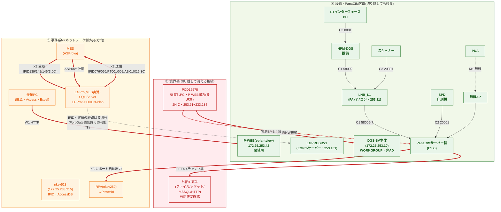

# PanaCIM データ授受一覧(ドラフト)

> 打合せ用のドラフト。**「資料根拠」列は2022版マニュアル・保管庫内解析記録に基づく記載であり、実環境の設定と一致する保証はない。** 「要確認」列の項目を現環境で確認して初めて切り離しルール(対応①)の設計入力になる。

## 1. システム構成(資料ベース・要実環境確認)

**図の読み方**: ラベルの番号は§2の授受一覧と対応。**緑区画(①)**=切り離しても生産が回るFA側(DGS-SV本体=172.25.253.10・P-WEB=172.25.253.42(eplantview)も253.0/24内に実在・閉域内)。**赤区画(②)**=境界を跨ぐ接続(赤線7本・うちX7が点線: W1・X2×2・X3・X7・E1-E4・SMB実測)で、切り離し設計の主役はここ(消すか中継点を作る)。SMB実測(445)はPCD15575からの実測。**GW実測(2026-11-02): 253側GW(172.25.253.254)と事務側GW(172.25.233.254)・事務区画GW(172.25.209.254)も同一MAC(00-09-0f-09-03-1e・Fortinet OUI=FortiGate)=同一L3装置**のため、事務↔253の遮断可否は同装置のポリシー設定次第。**事務専用PC(253 NIC無し)からの実測では253.0/24宛はICMP・TCPとも全滅・tracertは事務GWで停止=現時点で遮断済みの傍証(2026-11-02・型番とポリシー内容は要照会)。****黄区画(③)**=事務系側で、切る方向。位置が要確認なのはEGProの実所在(MES側かFA側か)。

## 2. データ授受一覧

| # | 授受内容 | 相手 | 経路・ポート | 方向 | 資料根拠 | 要確認(実環境) |
|---|---|---|---|---|---|---|
| W1 | Webアプリケーション(レポート・照会・VCP・生産オーダー管理) | 作業PCのブラウザ(IE11以上) | HTTP `http://<ip>/pmd`(ActiveX+JS) | ブラウザ→PanaCIM | 材料管理p121・トレーサp36・稼働モニタp150-151 | PHPの実体・Webサーバー種別・バージョン・URL・誰がどこからアクセスしているか。**実測(2026-11-02): レポート出力実働PCは2NIC(172.25.253.61/24 GW無し+172.25.233.234/23=事務GW 172.25.233.254)。253.0/24はroute printで「リンク上」のみ・固定ルート無し=閉域の傍証。253側の実通信はSMB(172.25.253.10:445)のみで、nbtstatにより253.10=**DGS-SV本体**(WORKGROUP・非AD)と確定。残る確認: ①事務GW/FWが253.0/24への経路を持つか(情報システム確認) ②DGS-SV(253.10)へのSMBアクセス元の棚卸し。**P-WEBの実URL=http://172.25.253.42/eplantview/(2026-11-02・利用者確認)=253.0/24内=閉域内で完結(不明点①解決)。2NIC実働PCのホスト名=PCD15575=X7の橋渡しPCと同一実機(2026-11-02 ipconfig)。事務専用PC(253 NIC無し)から253.10/42/61/254はICMP・TCP445/80/443とも不通・tracertは事務GWで停止=事務→253は遮断済みの傍証(2026-11-02)。253側ホストのOUI判定: 253.10=Dell・253.42=P-WEB=Dell・253.11=NEC・253.60=Intel製PC(2026-11-02)。**実測(2026-11-05): eplantviewはHTTP 401+Basic認証(realm="172.25.253.42")+X-ASPNET-VERSIONヘッダ=IIS+ASP.NET系。Server/X-Powered-Byは消去済みでPHPの痕跡なし=マニュアルの/pmd(PHP想定)と実装が異なる可能性・Gen2(新PHP対応)と実機の関係を要確認。253.0/24スイープで52台+GWが稼働(内訳は実行ログエントリ12)。** |
| E1 | ファイルエクスポート(XML/CSV) | 外部アプリ・共有フォルダ | ファイル | PanaCIM→外 | 外部IF p10/p17 | 出力先の実在と宛先 |
| E2 | ソケット送信(複数MES対応) | MES等サードパーティ | TCP・相手IP+ポート指定 | PanaCIM→外 | 外部IF p56-58・リール情報の定期ソケット出力(Base Time 08:00起点・Interval 60分) | 有効チャンネルの有無・宛先IP/ポート |
| E3 | データベース出力 | MSSQL | SQL(サーバー名/DB名/ユーザーID) | PanaCIM→DB | 外部IF p18 | 接続先・資格情報の管理方法 |
| E4 | ウェブサービス送信 | HTTP受口 | HTTPアドレス登録 | PanaCIM→外 | 外部IF p18 | 登録済みHTTPアドレスの有無(**PHP受口候補**) |
| I1 | 部品情報インポート | 外部アプリ | 標準書式ファイル | 外→PanaCIM | 外部IF p10 | 取込元・頻度 |
| C1 | 材料照合ソケット通信 | LNB(FAパソコン) | TCP 58002(設備→LNB)・58005/58006/58007(LNB/SP側)、ヘルスチェック40秒(トレーサビリティ: 58001/58002) | 相互 | 材料照合p64-69・トレーサビリティ | 現ラインで材料照合が有効か。**実測(2026-11-05 nbtstat): LNB=172.25.253.11(LNB_L1・NEC製OUI・WORKGROUP・ブラウザマスタ)=253.0/24内にFA側PCが実在** |
| C2 | SPD系照合 | SPD/印刷機 | TCP 20001 | 相互 | 材料照合p72 | SPDの有無 |
| C3 | 自動機種切替 | PTインターフェースPC(例10.140.66.217)・スキャナーターミナルサーバ(DIGI例・root/dbps) | TCP 8001・20301 | 双方向 | 自動機種切替p17 | PTインターフェースの実在・認証の実態 |
| M1 | PDA稼働モニター表示 | PDA | 無線AP経由 | PanaCIM→PDA | 稼働モニタ構成図 | APのSSID・電波範囲(**NKネットワークと共有か**) |
| X1 | 指図ファイル取得(BOSS計画.xlsm側) | ファイルサーバー等 | ファイル取得・**資格情報が図形テキストに平文埋め込み** | 外→BOSS | `TOOL改修問題(BOSS)/20261015_BOSS計画解析/README.md` | PanaCIMとBOSS計画の接続点の特定 |
| X2 | EGPro↔MESのIFID授受 | MES(ASProva側) | ファイル: 受取IFID139/142/146(3:00前後)・送信IFID076/066_SMT・PT001/PT002・A2I010(16:30バッチ) | 相互 | 引継ぎ資料「Pana-CIM EGPro関連」 | 授受先ホストの特定・nksv523のSend/Recvとの関係。**実測(2026-11-02): nksv523=172.25.233.215=事務系セグメント(232.0/23)に所在=IFID授受の中継サーバーは事務側。切り離すとIFID授受が断たれる→中継設計が必須の確定材料。nksv523のWebサーバーはApache/2.2.21(Fedora)+PHP/5.3.8(2026-11-02ヘッダ実測)=EOLスタック。nksv1359のSMT_result.plはEGProへ直接接続し10分ごとにSMT実績を取得(台帳記載)=EGProの所在未確定がX2と本依存の双方に影響。**実測(2026-11-05): EGProサーバー=EGPROSRV1(172.25.253.101)はFA閉域内に所在(AD DNS Aレコード無し・WORKGROUP)・nksv523はDNS上単一NIC=境界越えはFortiGateの個別許可ポリシーが最有力(要照会)・PCD15575経由ではない(253↔233間はPC自身でルート無し)** |
| X3 | PanaCIM生産レポート→PowerBI | RPA(nksv250)→PowerBI | Pana-CIM Excel集計.xlsmをRPAが9:30実行(PanaCIM側はレポート自動出力設定) | PanaCIM→RPA→PowerBI | 引継ぎ資料「各種システム一覧」 | レポート出力先フォルダ・RPAの接続方式 |
| X7 | PCD15575橋渡し | 事務NW×EGPro・PanaCIM系NW | 1台のPCが両NWに接続(EGPro・SSMSインストール済み) | 中継 | 引継ぎ資料「メモ」 | **切り離し時の扱いが最重要**・用途と利用者。**実測(2026-11-02): P-WEB出力PCと同一実機と判明(ホスト名PCD15575・253.61+233.234)。253側NICはGW無し=自己中継しない構成。他に独立したP-WEB出力PCがないかは要確認。台帳「メモ」シートにも「事務系NWと、EGPro・PanaCIM系NW両方と接続」の記述があり裏取り済み。253側NICはTP-LINK USB LANアダプタ(OUI 84-d8-1b・2026-11-02)。**実測(2026-11-05): 233側アドレス(172.25.233.234)を送信元にしたpingは253.42/.10とも100%損失=PCD15575であっても233源→253宛はFortiGateに遮断。橋渡しは253側ペルソナ(253.61)でのみ機能し、ネットワーク経路としての橋は存在しない。** |

## 3. 切り離しルール(対応①)検討のための論点

1. **境界線の切り方**: PanaCIMサーバー群+LNB+無線APを1つの独立セグメントにまとめ、NKネットワークとの間にFW/ACLで必要授受(C1・M1等の設備間通信)だけを許可する構成にするか。
2. **PCD15575の扱い**: 事務NWとEGPro・PanaCIM系NW両方に接続する橋渡しPCが存在(X7)。切り離し後も事務側から操作が必要な業務(SSMS・EGPro)があるなら、2NICの残置は境界の穴になる。専用端末化・踏み台化・業務のFA側移行のいずれかを決める必要がある。**実測(2026-11-02): P-WEBレポート出力の実働PCとPCD15575は同一実機(ホスト名PCD15575・2NIC 172.25.253.61/24 GW無し+172.25.233.234/23=事務GW 172.25.233.254)。判別手順の実行結果: 253.0/24は「リンク上」のみ・固定ルート無し・AD外(ADサーバーは172.30.x帯)で、253側の実通信はSMB(172.25.253.10:445)のみ・233側でM365/RDP。つまりこの端末は「253側=SMB(ファイル授受)」「233側=事務業務」の1台2役。さらにarp実測で253側GW(172.25.253.254)と事務側GW(172.25.233.254)・事務区画GW(172.25.209.254)が同一MAC(00-09-0f-09-03-1e・Fortinet OUI)=FortiGate 1台の複数SVIと判明。**事務専用PCからの実測で事務→253.0/24はICMP・TCPとも不通(2026-11-02)=現時点で253↔事務はこのFortiGateで遮断済みと考えるのが妥当。**切り離し設計は①2NIC端末の棚卸し(他の同型端末の有無を含む) ②253側SMB用途の中継化・移設 ③FortiGateの253↔233間ポリシー確認(情報システム側)、が主題になる。**追記(2026-11-05): 233→253方向は実測で遮断済み(PCD15575の233源pingも253.42/.10とも不通)。253→233方向もPCD15575のOSレベルでルート無し(253側NICはGW無しのため送信不可・「転送に失敗」)=PCD15575はどちらの方向にも中継しない。残るはFortiGateの個別許可ポリシーの列挙(X2/X3の経路)と2NIC端末の運用管理。**
3. **W1(Web)の閉域化**: P-WEBはブラウザ照会が業務で必須なら、アクセス可能なPCをFAセグメント内に限定(または専用端末)。外部(社外)からの到達可能性をゼロにする。P-WEB本体は172.25.253.42(253.0/24内・閉域)にあるため、到達経路の遮断は境界側(FW/ルーティング)の制御になる。**GW実測(2026-11-02): 同一L3装置=FortiGate(Fortinet OUI)で、事務専用PCからの到達テストにより253.0/24は不通と実証済み。さらに実測(2026-11-05): 2NIC端末の233源→253宛も遮断=双方向で完全閉域。W1の閉域化は既に成立しており、残るはFortiGateポリシーの内容確認(253→233方向の例外の有無)と2NIC端末(PCD15575)の運用管理。なお実測でeplantview=IIS+ASP.NET系+Basic認証(Server/X-Powered-By消去・PHP痕跡なし)。**
4. **E系チャンネルの棚卸し**: 有効になっているチャンネル(E1-E4)を列挙し、不要なものを無効化。ファイル授受で外部と連絡する経路(X1・X2)がPanaCIMデータを含む場合は迂回設計が必要。なお材料管理マニュアルによればOracle連携機能は未サポート(対象外)であり、DB出力の候補はMSSQL(E3)に絞られる。
5. **レガシー依存の棚卸し**: IE+ActiveX・SMB1.0・32bit ODBC・Perl CGIが現行必須設定。切り離しセグメント内ではこれらを許容する運用とし、セグメント外へは持ち出さない原則が必要。
6. **資格情報の平文化**: 引き継ぎ資料・BOSS計画・設備機器(root/dbps等の例示値)に平文認証が散在。切り離しを機に認証体系を再設計する機会にする。
7. **保守中止への当面対応**: 「PHP対応予定なし」の正確な意味は、**現行世代がPanaCIM Gen2(新PHP環境に対応済み)へ交代しており、現行のEEはサポート終了のためPHP対応の改修が永久に来ない**こと(社内での認識として記録)。よってEEの切り離し運用は恒久策ではなく**Gen2移行までの過渡期・時間稼ぎ策**という位置づけで設計する。PHP対応の交渉(対応②)は移行条件の確認を兼ねる。
8. **ライセンス認証の外部依存(要確認・盲点)**: メーカーツールはライセンスサーバー・オンライン認証を持つ場合がある。切り離すと認証・アクティベーションができなくなる可能性があり、**PANAへの直接確認事項**。月1回のPanaCIM再起動手順(SharePoint)が外部接続を必要とするかも併せて確認。

## 4. Phase 2 実環境チェックリスト(打合せ後)

- [ ] PanaCIMアプリサーバー/コントローラーサーバーの物理・VM配置とIP帯(進展: 253.0/24はARP58件をOUI分類済(2026-11-05・実行ログエントリ14)。VM確定=253.46(VMware)・Dellサーバー群(.10/.42/.45/.101/.102/.137)・HPE(.222)・Zebra16台・TAIYO YUDEN11台(無線PDA推定)・CONTEC4台・Extremeスイッチ(.68)。用途の棚卸しは現場照会)
- [ ] **DGS-SV(172.25.253.10)へのSMBアクセス元の棚卸し**(端末・用途・頻度)
- [x] Webサーバー種別の実測(2026-11-05): eplantview=HTTP 401+Basic認証+X-ASPNET-VERSION=IIS+ASP.NET系(Server/X-Powered-By消去)。PHPバージョンという論点自体が実装と乖離している可能性=Gen2とeplantviewの関係をPANA/情報システムに確認 ※マニュアルの/pmdと実URL/eplantviewの対応も含む
- [ ] `netstat`でリッスンポート一覧(58002/58005-7/20001/8001/20301/80等の該当)
- [ ] 外部IFのチャンネル設定(コンソール: 全般設定・エクスポート設定)の実値
- [ ] NKネットワークとの境界(FW/ルータ)設定・無線APのSSIDと所属セグメント
- [ ] Webクライアント(ブラウザ)利用実態: 利用者・台数・アクセス元PC
- [ ] nksv523側のIFファイルにPanaCIM由来データが含まれるか
- [ ] **サーバーOS・ESXi・仮想化基盤のバージョンとEOL状況**(EEの寿命はPHP以外の基盤層にもある)
- [ ] **ライセンス認証・アクティベーションの外部依存の有無**(PANA確認)
- [ ] PCD15575(=P-WEB出力PCと同一実機と判明)の実際の用途・利用頻度・利用者・他に同型2NIC端末がないかの棚卸し
- [x] **境界L3装置の特定と事務→253到達テスト(2026-11-02完了)**: 253/233/209各区画のGWは同一MAC(00-09-0f-09-03-1e・Fortinet OUI)=FortiGate 1台。事務専用PC(253 NIC無し)から253.10/42/61/254はICMP・TCP445/80/443とも不通・tracertは事務GWで停止=事務→253は遮断済みの傍証
- [ ] **FortiGateの型番・253↔233間ポリシーの内容確認**(管理UIは443/80/22閉鎖・23フィルタのため、情報システム側への照会またはコンソール)・**特にEGPROSRV1(253.101・EGProサーバー)とnksv523/nksv1359/nksv250関連の個別許可ルール(X2/X3の経路)**
- [ ] 「基本操作編(Webアプリケーション)」マニュアルの入手(PANAに確認)
