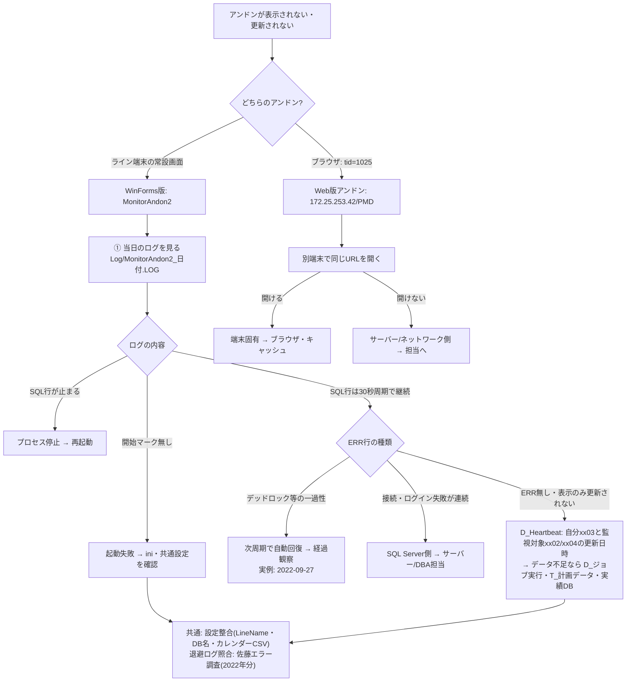

# PanaCIM・LNB関連システム情報(共有サーバー所在)

**2026-11-02 時点。PanaCIM管理文書・相関図の素材候補として、共有サーバー上のシステム所在をまとめたもの。**

出所: 2026-11-02 に共有サーバー \\nksv569.ad.nkc.co.jp の2共有(Share・WWW、計408,760ファイル)へキーワード「アンドン」で総合検索した際に把握した所在。ファイル名一致131件・内容一致12件。照合はUTF-8/CP932両系の文字コードで行い、Officeファイルは内部XMLまで展開して照合した。圧縮アーカイブ内部のファイルとOffice埋込画像は対象外。

## 関わりがありそうなシステム

### 1. Pana-CIM レポート収集(mnt\DGS-SV 直下)

- 場所: `\\nksv569.ad.nkc.co.jp\Share\mnt\DGS-SV\Pana-CIM_report\`
- 構成: `robocopy.bat`・`log.log`・`DIR\`
- `DIR\` 下に **L1/L2/L3 機種切り替えレポート・稼働時間レポートのCSV**(各ライン、毎営業日10:00/10:05出力、2026-01-23〜2026-10-31分の存在を確認)と `Daily\`・`Monthly\`・`Shift\`・`Weekly\`・`個別レポート\` のサブフォルダ。
- Pana-CIMが出力するレポートの収集先。robocopy.bat が取得元から集めている構成と推定(batの中身は未確認)。

### 2. PanaCIM 関連データ一式(★個人フォルダ配下)

- 場所: `\\nksv569.ad.nkc.co.jp\Share\mnt\DGS-SV\★個人フォルダ\PanaCIM\`
- 構成: `Historical\`・`Log\`・`Production\`・`Utils\`
- `Production\RestoreLog\RestoreDB_Log_20201226.log` — DB復元のログ(2020-12-26時点。キーワードの内容一致を確認)。
- 実行サーバー本体は別にある可能性。データ退避・参照用の所在と推定(未確認)。

### 3. MonitorAndon2(アンドンモニタ・EGPro-KOHDENクライアント)

本体が3所在(配置からEGProのクライアント構成と推定):

```
\\nksv569.ad.nkc.co.jp\Share\mnt\DGS-SV\EGP_たぶん古い\EGPro-KOHDEN\Client\MonitorAndon2\
(exe・exe.config・ini)

\\nksv569.ad.nkc.co.jp\Share\mnt\DGS-SV\Line-1 EGPro データ退避\EGPro-KOHDEN\Client\Application\MonitorAndon2\
(exe・exe.config・ini)

\\nksv569.ad.nkc.co.jp\Share\mnt\DGS-SV\★個人フォルダ\佐藤\エラー調査\MonitorAndon2\Log\
(実行ログ MonitorAndon2_YYYYMMDD.LOG ×123、2022-07-01〜11-26)
```

補足:

- `Line-1 EGPro データ退避\Desktop\L1_アンドン.url` — **Web版アンドン**へのショートカット: `http://172.25.253.42/PMD/VCP.aspx?tid=1025`(2023-06-29作成)。MonitorAndon2(下記のWinFormsアプリ)とは別系統のWeb画面。
- `整理\1\MonitorAndon2_20220210.LOG` — 整理フォルダに単体のログ1本。

実体(2026-11-02にini・exe.config・実行ログで確認):

- 正式名称は **EGProアンドンアプリ**(Panasonic FS Engineering製・2019・.NET Framework 4.5・ver 2.0.0.16)。1920×1080のライン端末モニタ用WinFormsアプリ。
- ライン別インスタンスで動く。ini の `LineName` が EGP_たぶん古い側=Line-2・Line-1データ退避側=Line-1、佐藤調査の実行ログはLine-3。アプリコードはライン番号+機能番号(あんどん=xx03・生存確認対象=xx02/xx04)。
- 参照先は EGPro2 の SQL Server 群: `EGProKOHDEN-MST`(マスタ)・`EGProKOHDEN-ASPRV_Plan`(アスプローバ計画)・`EGProKOHDEN-Plan`(計画)・`EGProKOHDEN-List`(帳票)。実行ログでは `[EGProKOHDEN-Plan].[dbo].[D_Heartbeat]`(アプリ生存監視)と `[EGProKOHDEN-Plan].[dbo].[D_ジョブ実行]`(計画グループ)を30秒間隔で照会していた。
- 表示内容: 生産状況(30秒更新)・指図一覧の色分け・カレンダー(Q:\カレンダー.csv 参照)・製造時間の既定値(20秒・効率1.0)。関連アプリの生存確認(60秒×5回)も行う。
- 同梱物: `local_MonitorCommonSettings.ini`(共通設定)・`カレンダー.csv`・`共通部品.dll`。ログは20日保存・SQL出力あり(DebugMode=2・1日約3.7万行)。

### 4. EGPro-KOHDEN(生産データシステム)周辺

- `mnt\DGS-SV` 直下に `EGPro-KOHDEN\`・`EGP_たぶん古い\`・`Line-1 EGPro データ退避\` の3系統。MonitorAndon2 はこの配下にある。
- 周辺には `■1Line_JOB\`・`■2Line_JOB\`・`■3Line_JOB\`・`bat\`・`SQL文\`・`sqlcmd\`・`◎棚卸し\`・`稼働率\`・`計画\` などのフォルダ(ライン別JOB・SQL・集計系)。
- BOSS計画・生産負荷シミュレーション(鹿島引き込み案件)が参照するデータ源でもある。

### 5. qcd_DB(WWW共有・Python製Webシステム)

- 場所: `\\nksv569.ad.nkc.co.jp\WWW\cgi\qcd_DB\`
- 構成: `Debug\`・`Release\`(ともに `Main.py`・`ManualUpdate.py`・`html\`・`Mod\`)・`etc\env\`・`Files\`
- `Files\` 下: mdbtools 1.0.0 / 1.0.0-beta7(展開済み+tar.gz)・`perl\`・`websocket\`・`差分チェックシステムのバックアップ\`・`イメージ図.dio`・`イメージ図.png`・`サーバー設定メモ.txt`
- mdbtools(LinuxからAccess(mdb)を読むツール)を同梱していることから、**QCDデータをAccess DBで持ち、Web画面(Python)で閲覧するシステム**と推定。cgi配下にありwebsocket対応。
- `イメージ図.dio`(drawio形式)はシステム構成を図示した素材の可能性があり、相関図作成時の参照候補(中身未確認)。
- 設定メモ・env・Main.py は未読(認証情報を含む可能性のため。中身を見る場合は利用者が開くこと)。

### 6. LNB

- 今回の検索ではLNB関連の新所見なし。
- LNB = Line Network Box(LNB管理書 §3・2026-10-14確定)。iLNBとの同一性は未確認(W43からの持ち越し事項)。

## 確定・推定・未確認

- **確定**: 上記の所在と構成(2026-11-02に実在を確認)。アンドンの実体 = MonitorAndon2(EGProアンドンアプリ・EGPro2の4DBを30秒間隔で参照するライン別モニタ)+別系統のWeb版アンドン(`L1_アンドン.url` → 172.25.253.42/PMD/VCP.aspx?tid=1025)。
- **推定**: qcd_DBの用途(mdbtools同梱からの推定)・Pana-CIM_reportがrobocopy収集であること。
- **未確認**: PanaCIM本体(実行サーバー)の所在・qcd_DBとPanaCIM/LNBの関係・MonitorAndon2とPanaCIMの連携の有無・Pana-CIM_reportの取得元・Web版アンドン(PMD)の実体・MonitorAndon2の現役性(2022年のログが確認上の最新)・iLNB同一性。

## アンドン不具合時に見る場所(切り分けの型)

**最初の区別**: 不具合の画面がどちらかを確認する。
- WinForms版: MonitorAndon2.exe(EGProアンドンアプリ)をライン端末で起動して表示
- Web版: ブラウザで `http://172.25.253.42/PMD/VCP.aspx?tid=1025`(L1_アンドン.url の参照先)

### WinForms版・表示されない/更新されないとき

1. **当日のログ**: `C:\EGPro-KOHDEN\Client\MonitorAndon2\Log\MonitorAndon2_YYYYMMDD.LOG`(ini の LogFolder・保存20日のみ)
   - `PRC ☆☆☆☆☆ アプリケーション開始 ☆☆☆☆☆` と `Version:` 行 → 起動自体が成功したか
   - `SQL` 行が30秒間隔で続いているか → 更新処理が生きているか
   - エラーは `[:0] ERR 例外発生[...]` + `場所 ...` のスタックトレース形式で記録される
2. **エラーの種類で分ける**(実例: 2022-09-27 23:41 の SQL Server デッドロック)
   - デッドロック・タイムアウト等の**一過性DBエラー** → アプリは次の更新周期で自動回復する(実例でも10秒後に処理継続)。表示が戻らないときだけ深掘り
   - 接続エラー・ログイン失敗の**連続** → DBサーバー側(EGProKOHDEN-* の SQL Server)・認証・ネットワークの障害。サーバー/DBA担当の領域へ
3. **DB側の生存監視**: `[EGProKOHDEN-Plan].[dbo].[D_Heartbeat]`
   - 自分(xx03)の 更新日時が現在時刻付近か。起動中フラグ=1でも更新日時が止まっていれば実質停止
   - 監視対象(xx02/xx04)の 起動中フラグ/更新日時 → **表示の元になる他アプリの停止**がここで分かる
4. **表示データの供給元**(画面に出ない=データ側に無い可能性): `[D_ジョブ実行]` でライン名称→最新の計画グループを取得 → `[T_計画データ]`/`[T_計画データ_Sub]`(指図一覧: 品番・ロット・計画数量・開始/終了・完了フラグ)+ `[EGProKOHDEN-ASPRV_Plan].[V_ProcessTime]`(製造効率・段取時間)+ `[EGProKOHDEN-MST].[V_ライン設備情報]`/`[M_生産品番マスタ]` + `[EGProKOHDEN-List].[T_ProductResultLst]`(先頭/最終設備の実績台数・枚数)
5. **設定の整合**: `MonitorAndon2.ini`(LineName・4つのDB名・RefleshInterval・TargetID)・共通設定 `C:\EGPro-KOHDEN\Client\Application\MonitorCommonSettings.ini`・`カレンダー.csv`(Q:\ 直下)
6. **過去の調査ログ**: `\\nksv569.ad.nkc.co.jp\Share\mnt\DGS-SV\★個人フォルダ\佐藤\エラー調査\MonitorAndon2\Log\`(2022-07〜11・123本)。現場ログは20日で消えるため、この退避分に同型事象がある可能性

### Web版・表示されないとき

1. **別端末で同じURLを開く**(端末固有かサーバー側かの切り分け)。実測: 本PC(社内LAN)から 172.25.253.42 へは2026-11-02時点でタイムアウト → ネットワーク分離かサーバー状態かはここでは判定できないため、現場端末での確認が必須
2. `tid=1025` は画面/ラインの固定IDと推定

### 図解草案(mermaid・素材)

Obsidian描画用の草案。**管理書側への統合依頼済み(2026-11-02・利用者判断)** — 相関図第三案の採否後の管理書改訂時に、このフロー図を素材として図解に統合する。Pana-CIM側の正本編集は管理書レーンが行う。



### 図解に載せる場合の留意

- 確認できた証跡は2022〜2023年時点(ini改訂2021・ショートカット2023)。**現行でWinForms版/Web版のどちらが現役か・エスカレーション先は未確認**であり、現場確認を前置きする必要がある
- 一過性デッドロックで復旧することを含めて描くと「ERRがあっても即障害ではない」伝えられる

## 関連ノート

- `../01_成果物/管理書.md`(Pana-CIM側正本)
- `../01_成果物/LNB管理書.md`(LNB側正本)
- `../01_成果物/PanaCIM_点検文書_情報記入シート.md`・`../01_成果物/LNB_点検文書_情報記入シート.md`
- `2026-11-02_相関図LNBStage5適用.md`
- `../README_管理規則.md`

## 管理文書への記載(2026-11-02)

- `../01_成果物/管理書.md` §4-2 相関図へ所在の要約を追記し、第14章 要確認事項一覧へ No.28(アンドン表示とMonitorAndon2の関係)·No.29(Pana-CIM_reportの収集元)·No.30(PanaCIM実行サーバー本体の所在)を追加した。
- LNB管理書は「LNB関連の新所見なし」のため変更していない。
- 相関図(未承認の第三案)への反映は採否判断後の改訂時に行う。
