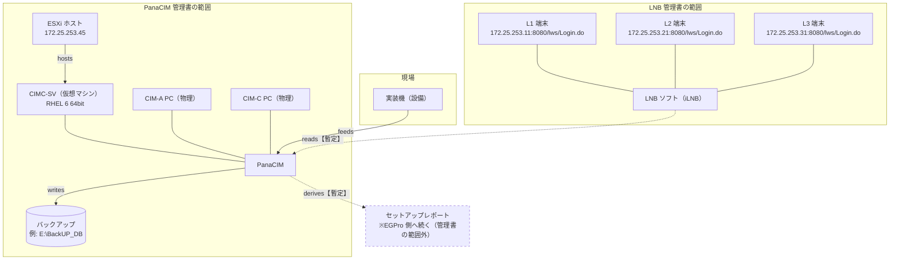
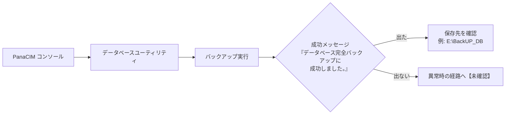
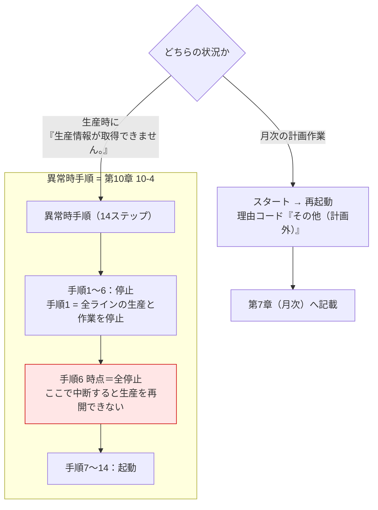

# 関係マップ(管理書範囲) PanaCIM / LNB

**管理書・点検手順書へ転記できる粒度に限定した図。**
EGPro・棚卸し・RPA は対象外(→ [[02_全体網羅_システム関係]])。

語彙の定義は [[03_オブジェクト台帳]]。表記は【確定】【暫定】【未確認】。

---

## 1. 対象の境界

**先に「何を管理対象とするか」を決める。**ここが決まらないと点検項目が書けない。

| | PanaCIM | LNB |
|---|---|---|
| 管理対象ソフト | PanaCIM【確定】 | iLNB【確定】 |
| 社内呼称との関係 | 会議資料は Pana-CIM | **「LNB」= 承認済み L1〜L3 端末 + 稼働 LNB ソフト【確定】。`iLNB` と同一とは断定しない** |
| サーバ | CIMC-SV(VM) / CIM-A PC / CIM-C PC【確定】 | 【未確認】 |
| 端末 | 【未確認】 | L1 / L2 / L3【確定】。台数・設置場所【未確認】 |
| バージョン | 未指定 | 未指定 |
| ベンダー | パナソニック コネクト【確定】 | パナソニック コネクト【確定】 |
| 対象外 | EGPro、ASprova(別担当)【確定】 | 同左 |

---

## 2. 構成図

**点線は【暫定】または管理書の範囲外。**実線だけが管理書に書ける関係。

---

## 3. 管理書へ転記する項目と、現在の埋まり具合

転記元は [[PanaCIM_点検文書_情報記入シート]] / [[LNB_点検文書_情報記入シート]]。

| 欄 | 転記先 | PanaCIM | LNB |
|---|---|---|---|
| A 対象の定義 | 管理書 | 一部【確定】 | 一部【確定】。範囲が未確定 |
| B 保守範囲 | 管理書 | ベンダー名のみ | ベンダー名のみ |
| C 体制 | 管理書 | 作成担当のみ【確定】 | 同左 |
| D 実施条件(頻度) | 管理書 | **空欄** | **空欄** |
| E 接続と認証 | 点検手順書 | **空欄** | 接続先は判明【確定】。権限欄に記載あり |
| F 点検項目 | 点検手順書 | 協議案6件(仮置き) | **実質空欄。候補1件のみ** |
| G 異常時の対応 | 管理書 + 手順書 | **空欄** | **空欄** |
| H 記録 | 管理書 + 記録票 | **空欄** | **空欄** |
| I 文書の様式 | 4文書共通 | ZZZ-90000【確定】 | 同左 |
| K 期限 | 作業計画 | 2026-12-28 登録 / 2027-01-05 トライアル【確定】 | 同左 |

**律速は F(点検項目)。**特に LNB は聞き取りが進まないと手順書本体に入れない。

---

## 4. 運用フロー(管理書に書く対象)

### 4-1. バックアップ【確定】

**会議での発言【確定】:** サーバー内部まで見られなくても、
**バックアップデータが取得できている事実を確認できれば当面は足りる。**
→ 点検項目 F-2(バックアップ実行)と F-3(バックアップデータ)を先に定義する根拠。

### 4-2. 再起動【確定】**2種類ある。取り違えると生産を止める**

**管理書では章を分ける【確定】。**第7章(月次)と第10章10-4(異常時)。
**原文には停止/起動の区切りが無い。**文書側で明示する。

---

## 5. 10/19・10/21 で示すもの

| 回 | 示すもの | 本マップでの担保 |
|---|---|---|
| 10/19 三者レビュー | 設計思想・作成根拠、会議決定事項の反映 | §1 境界 / §2 構成図 / §4 運用フロー |
| 10/19 三者レビュー | 実装済み・実装予定の切り分け | §3 の埋まり具合の表 |
| 10/21 作成チーム確認 | 成果物(モック)と残作業 | §3 + §6 |

**「実装済み」と「実装予定」を混ぜない。**§3 の表で空欄を隠さないこと自体が証跡になる。

---

## 6. この図で埋まっていないもの(レビューで聞く)

| # | 内容 | 影響 | 確認先 |
|---|---|---|---|
| 1 | LNB の点検項目(F 全行) | 点検手順書の本体が書けない | 現行実施者 |
| 2 | LNB のサーバ・端末台数・設置場所 | 対象の定義が確定しない | 現行実施者 |
| 3 | 「LNB」と `iLNB` の関係 | 文書名と対象範囲が決まらない | 現行実施者 |
| 4 | PanaCIM の点検実施者・確認者・承認者 | 役割欄が埋まらない | 管理責任者 |
| 5 | 頻度区分(日次/月次/年次)と実施時間帯 | 管理書の中核が空 | 作成チーム協議 |
| 6 | 異常時の連絡先と中断条件 | 本番のみの環境で止まる判断ができない | 管理責任者 |
| 7 | 記録の様式・保存先・保存期間 | 点検記録票が作れない | 作成チーム協議 |
| 8 | ZZZ-90000 の入手先、三欄追加の可否 | 様式が確定しない | 様式管理部署 |
| 9 | `Pana-SIM`(WinActor シナリオ名)が PanaCIM と同一か | 管理対象に RPA が入るか変わる | 現行実施者 |

**9 は今回の台帳収集で `.ums7` が出てきたら再確認する。**

---

## 7. 機微情報の扱い

引き継ぎ資料に平文のパスワードが並んでいる記録がある【確定】。

- **管理書・手順書へ値を転記しない。**E-5 には**保管場所のみ**書く。
- 台帳収集・OCR でも該当ファイルは本文を読まず、**所在のみ記録**する。
- 文書化が漏洩経路にならないよう、置き場所を決めてから E 欄を埋める。

---

## リンク

- [[00_関係マップMOC]]
- [[03_オブジェクト台帳]]
- [[PanaCIM_点検文書_情報記入シート]]
- [[LNB_点検文書_情報記入シート]]
- [[PanaCIM・LNB点検文書にSOPと管理書の二層を採用する理由]]
- `10_業務全般/PanaCIM_LNB/PanaCIM_LNB_関係図.drawio`(確定版の配布用)
