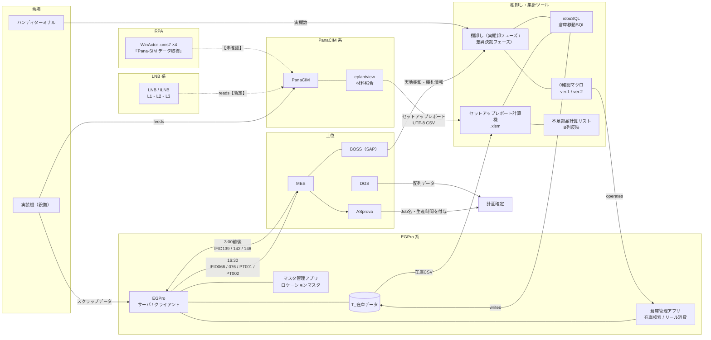
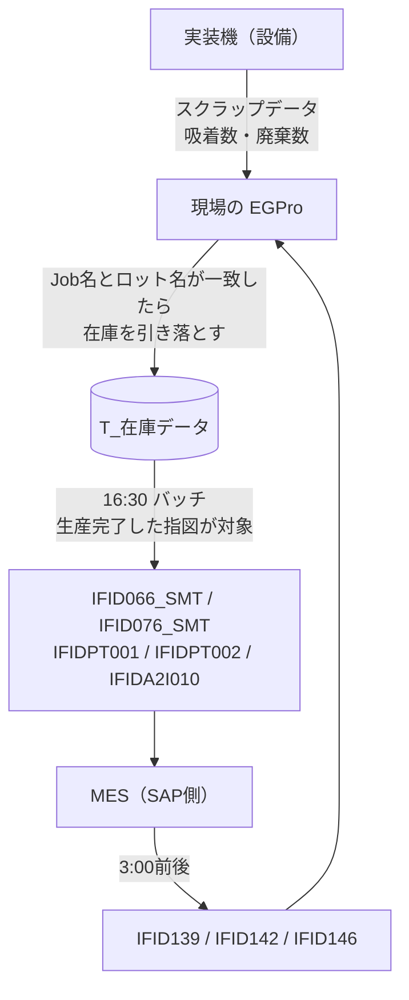
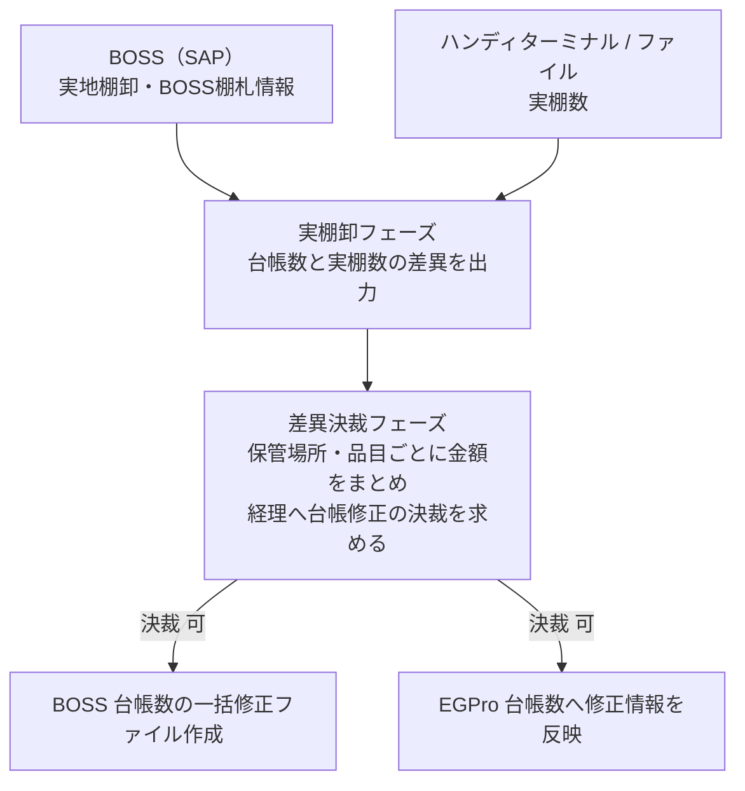
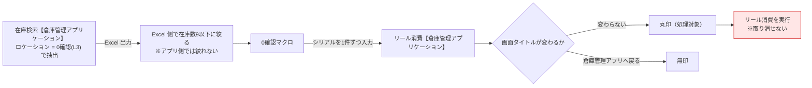
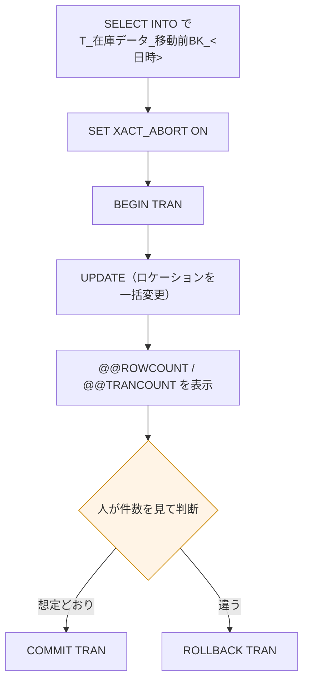
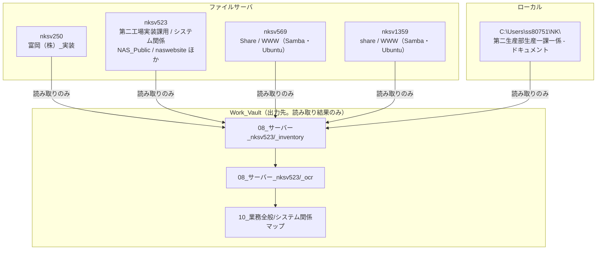

# 関係マップ(全体網羅)

設備から MES/BOSS までを1枚で追えるようにする図。**将来的にここへ全部を集約する。**
管理書に書く範囲だけが要るときは [[01_管理書範囲_PanaCIM_LNB]]。

語彙の定義は [[03_オブジェクト台帳]]。表記は【確定】【暫定】【未確認】。

---

## 1. 全体像

---

## 2. ロス情報の経路【確定】

**「EGPro の在庫数を PanaCIM から採取する」は向きが逆。**
ロスの元データは **設備 → EGPro** へ上がる。

**ロスという欄は無い。計画と実績の差として出る【確定】。**

| 何 | ファイル | 項目 |
|---|---|---|
| 計画(使うべき数) | `IFID139.csv` 指図BOM | **必要数** |
| 実績(実際に使った数) | `IFIDPT001.csv` 使用部品情報 | **使用品目数量** |

突き合わせの鍵は **指図番号 + 構成品目コード(+ ロット番号)**。
ただし **`IFID139` 側にロット番号が無い【確定】**。計画はロット単位で持っていない。
→ **ロットまで割れるのは実績側だけ。合計で比べるしかない。**

### 2-1. 差異が出る4つの原因【確定】

**「壊れている」のではなく「止めていない」。報告書では書き分ける。**

| # | 起きること | なぜ差異になるか |
|---|---|---|
| 1 | 在庫が0以下になる引き落とし | エラーが出ない。引き落とされないが**実績はカウントされる** |
| 2 | シリアル在庫を超える実績 | そのまま MES へ送信。EGPro 側で止めていない |
| 3 | トレイ部品 | 半分オフライン。バーコードを読み漏らしても実装が始まり、**実績が Null** |
| 4 | 同一Z軸・同一部品名で別シリアル | 前の部品のロケーションが **0確認** へ変わる。**棚卸しの0確認の発生源** |

---

## 3. 棚卸しの流れ【確定】

出典の所在: `\\nksv523.ad.nkc.co.jp\第二工場実装課用\1係用\060_システム関連\EG Pro\EG Pro棚卸し機能`【確定】

### 3-1. 0確認とリール消費

**`リール消費` 画面の入力欄は1行のみ【確定】。**一括貼り付け欄は無い。
→ **1件ずつ送る設計は正しい。** ver.2 の方向性を変える理由はない。

**件数の3つを区別する【確定】。**
CSV 29,246行 / 「0確認」を含む 6,884行 / 0確認かつ在庫数9以下 5,848件。
**別日時の CSV では 5,848 にならない。期待値として使い回さない。**

### 3-2. 倉庫移動SQL(idouSQL)の安全性【確定】

**安全性は UPDATE と COMMIT の間に人の目を挟むことで成り立っている【確定】。**

- `WHERE` は**シリアル列挙のみ**。現在ロケーションを条件にしない。
- → **移動済みや対象外が混じっても止まらない。**
- → **A55 の移動先コードを誤ると、正しい件数を誤った倉庫へ移す。**ここが最も静かに事故る。

移動先コード: **201=1L / 202=2L / 203=3L / 213=3Lトレイ。208 は廃止**【確定】

**トランザクション運用は v1.0 から無改修【確定】。**
第三者向け資料では **「変更点」ではなく「変えていない点」**として書く。

---

## 4. ファイルの所在(5系統)

台帳収集の対象。**命名規則が統一されていない前提で扱う。**

**既知の所在【確定】**

| 何 | 所在 |
|---|---|
| EG Pro 棚卸し機能の仕様書 | `\\nksv523...\第二工場実装課用\1係用\060_システム関連\EG Pro` |
| EGPro プログラム本体 | サーバ・クライアント共に `C:\EGPro*\Application` |
| EGPro ログ | `Application` と同一階層。**1週間で削除** |
| 連携の再実行 | デスクトップの `ReUpperDown` フォルダ |
| バッチ時刻の変更 | 実行プログラムと同フォルダの ini |

---

## 5. 現在の課題との対応

| 課題 | 関係するノード | 本マップで見るところ |
|---|---|---|
| 棚卸セット ver2 | `TOOL.ZERO_V2` `TOOL.IDOUSQL` `APP.WH.REEL` `DB.T_ZAIKO` | §3-1 / §3-2 |
| LNB・PanaCIM 管理書 | `SYS.PANACIM` `SYS.LNB` `HOST.*` | [[01_管理書範囲_PanaCIM_LNB]] |
| TOOL.xlsm 容量確認 | `TOOL.CAPACITY` | **未マッピング。台帳で実物を特定してから追記** |
| ロス情報の報告(WIP.md 1番) | `IF.139` `IF.PT001` | §2 |

---

## 6. 未確認・未着手(この図の穴)

| # | 内容 | なぜ要るか |
|---|---|---|
| 1 | `IFIDA2I010.csv` の定義 | 2025年追加。定義書に無い |
| 2 | プラントが `B010`(実データ)と `B020`(定義) で違う | どちらが何を指すか |
| 3 | 単位が `PC`(実データ)と `ST`(定義) で違う | 向きで単位系が違う可能性 |
| 4 | `Pana-SIM`(WinActor シナリオ名)と PanaCIM の関係 | RPA が管理対象に入るか変わる |
| 5 | `.ums7` 4本の中身 | WinActor が無いと開けない可能性 |
| 6 | 在庫検索画面の `編集` ボタンで一括更新できるか | できれば idouSQL の位置づけが変わる |
| 7 | `TOOL.CAPACITY`(TOOL.xlsm) の実物と処理フロー | 課題3の要件が固まらない |
| 8 | WIP.md が言う「cgi」の正体 | **MES連携とは別物**。在庫照会用の出力と推定【暫定】 |
| 9 | nksv569 / nksv1359 の用途 | Samba/Ubuntu。何が置かれているか未調査 |
| 10 | nksv250 `富岡（株）_実装` の用途 | 未調査 |

**9・10 は今回の台帳収集で埋まる見込み。**

---

## リンク

- [[00_関係マップMOC]]
- [[01_管理書範囲_PanaCIM_LNB]]
- [[03_オブジェクト台帳]]
- [[EGPro_PanaCIM連携インターフェース]]
- [[棚卸セットver2_実物同定と初期調査_2026-10-07]]
- [[倉庫移動SQL_idouSQL_仕様書]]
