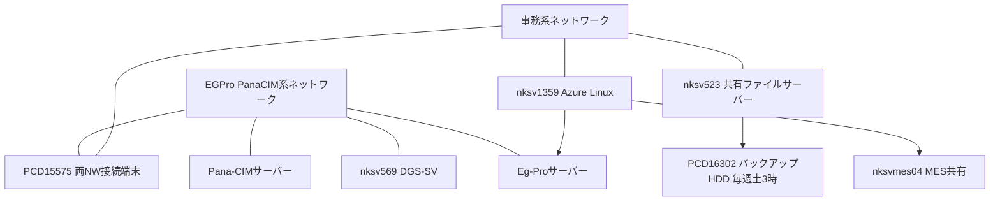

# Pana-CIM・Eg-Proサーバー管理体制 事前整理

2026年9月16日13時から15時、竹渕さん開催の打ち合わせ向け。
手元にあるのは佐藤(勇)さんの引き継ぎ資料だけなので、そこから言えることと言えないことを分けて書く。

参加区分は任意だが、引き継ぎ資料に「篠原さんに一時的にITポータル上の管理者を移譲済み」と明記されている以上、議題の「管理責任者および担当者の決定」で名前は出る。自分のスタンスは先に決めておく。

## 資料から復元できる資産

| ホスト名                   | 役割                                                                           | 状態                                                  |
| ---------------------- | ---------------------------------------------------------------------------- | --------------------------------------------------- |
| nksv523.ad.nkc.co.jp   | 第二工場実装課の共有ファイルサーバー。実装状況表、部品リスト.accdb、SetupFile、auth_mgt.html                 | 自身のバックアップ機能が2026年6月10日に異常動作。バックアップ元を破壊する挙動だったため無効化中 |
| PCD16302（富岡ロボット9）      | nksv523のバックアップHDD接続先                                                         | タスクスケジューラで毎週土曜3時に同期。暫定運用                            |
| nksv250.ad.nkc.co.jp   | Office365と.NET Framework 3.5の配布元。nksv1359から読み取り専用でマウントされている                  | 特記なし                                                |
| nksv569.ad.nkc.co.jp   | DGS-SV。部品一覧の出力元                                                              | 特記なし                                                |
| nksv560.ad.nkc.co.jp   | 旧システム                                                                        | 現役かどうか不明                                            |
| nksv1359.ad.nkc.co.jp  | 富岡みらい生産系クラウドサーバー。Azure上のLinux、実行ユーザーはsmtadmin                                | 更新経路が異常で、手動更新手順あり                                   |
| nksvmes04.ad.nkc.co.jp | MES側の共有。SMT_RCVとdownloadをnksv1359が読み取り専用でマウント                                | 特記なし                                                |
| PCD15575.ad.nkc.co.jp  | 事務系NWとEGPro・PanaCIM系NWの両方につながる作業端末。SQL Management Studio、EGPro、Office365導入済み | ITポータル管理者が篠原へ一時移譲済み。                                |

## バックアップ障害は2件ある

案内文の事象と引き継ぎ資料の事象は別物で、独立して起きている。

Eg-Proからサブサーバーへの自動バックアップは2025年頃から正常に実施されていなかった。8月5日に大塚さんと松井さんがEg-Proサーバーを再起動した際に判明し、現在は復旧済み [1]。1年以上、誰も気づいていない。

nksv523のほうは2026年6月10日にバックアップ機能が異常動作した。
しかもバックアップ元を壊す挙動だったため機能を止め、HDDを外してPCD16302につなぎ、タスクスケジューラで週次同期させている。今もその暫定状態のまま。

原因の形は同じで、成否を見る人がいなかったから放置された。手順書を作るだけでは同じことが起きる。誰がどこで結果を確認し、失敗時に何をするかまで決める必要がある。この点は会議で主張する。

## 議題ごとの整理

### 管理範囲の整理

周辺資産は上表の範囲で棚卸しできる。PCD15575が事務系と生産系の両方につながる特殊な端末であることは共有しておきたい。

Pana-CIMについて資料から分かるのは構成コンポーネントとバージョンまで。PanaCIMアプリケーション、CIMC(Linux)、PanaCIMデータベース、ライセンスサーバーがいずれも8.8.3.1で、2020年12月26日のビルド日時が記録されている [2]。コンソールにはpanadmin権限のオペレーターが多数登録されたままになっている。一方でサーバー本体のホスト名、IP、設置場所、保守ベンダーの記載はない。「PanaCIM バックアップ IP_PW.pdf」というファイル名だけが資料中に見えるので、現物を押さえるところから始める。

Eg-Proも同様で、端末側のアプリとDB接続情報としてしか出てこない。nksv1359のcron(qcd_DB)からEG-Pro部品マスタとAsprovaを取得し、SMT_result.plがEGProへ直接接続して生産実績を引いている [2]。つまりEg-Proが止まるとQCD可視化システムが道連れになる。この依存関係は管理範囲の議論に入れる。

### 手順書の作成方針

素材はそれなりに揃っている。資格情報の登録コマンド、ODBC設定、トラストセンターの設定、SMB1.0の有効化、Officeと.NETの導入手順まで、端末セットアップはほぼ書ける状態。よくある不具合と対処もシートに残っている [2]。

ただし資料には平文のパスワードが並んでいる。nksv523はユーザー名もパスワードもホスト名と同じ文字列で、しかもvers=1.0のSMBでマウントされている。MES共有のマウントにはEGProアカウントの認証情報がそのまま書かれている [2]。そのまま手順書へ転記する前に、資格情報をどこに置き誰が持つか、いつ棚卸しするかを決めたい。

### 定期点検項目

資料から拾える実施項目。点検表のたたき台に使う。

| 項目 | 頻度 | 備考 |
| --- | --- | --- |
| nksv523からPCD16302への同期の成否確認 | 週次 | 同期自体は土曜3時。確認作業は未定義 |
| Eg-Proのサブサーバーへのバックアップ成否確認 | 未定 | 今回の事象 |
| nksv1359のcronログ確認 | 日次 | 指図情報更新は失敗を見越して7時10分と10時の二重実行になっている |
| 共有Excel（実装状況表）のリセット | 月1回程度 | 資料に手順あり |
| EGProとMESの差異確認 | ほぼデイリー | 別資料あり |
| 品目BOMデータベース整備 | 週1程度 | DGSからcsv出力して取り込み |
| 試作登録 | 毎週火曜 | BOSS計画.xlsmに手入力 |
| 祝日登録 | 年1回 | 同上 |
| 無線証明書の更新 | 毎年 | 制限セグメント wpa2Wireless5 |

### バックアップ運用と復旧手順

nksv523の暫定運用は説明できる。ただし復旧手順、つまり実際に戻せるかを検証した記録は資料のどこにもない。取れているように見えても、リストアを試した人がいない可能性が高い。ここは会議で必ず出す。

### 管理責任者と担当者

PCD15575のITポータル管理者は「一時的に」篠原へ移っている。ITポータルからの申請は天野さんの承認で通り、備品はAmazon Businessと楽楽精算、窓口は茂木絵美さん。

問題は「一時的」の期限と範囲が決まっていないこと。このまま恒久化しかけている。正式に引き受けるのか、別の方へ戻すのかを今日決める。

### その他の課題

EGProがメーカーに伝えないまま入っている端末がある。手順書に書けない運用が存在するということなので、書面化するならライセンスと保守契約の整理が先になる。
nksv1359のscheduled配下には、用途不明のまま残っているプログラムがある。set_DLVは自動実行にも登録されておらず、update_BOMは何に使われているか分からない。ecnUpdateとCMDI_Next_Importは未使用 [2]。資料の書き手自身が用途を把握しきれていない状態で引き継がれている。

リール

CSV文書の確認について
